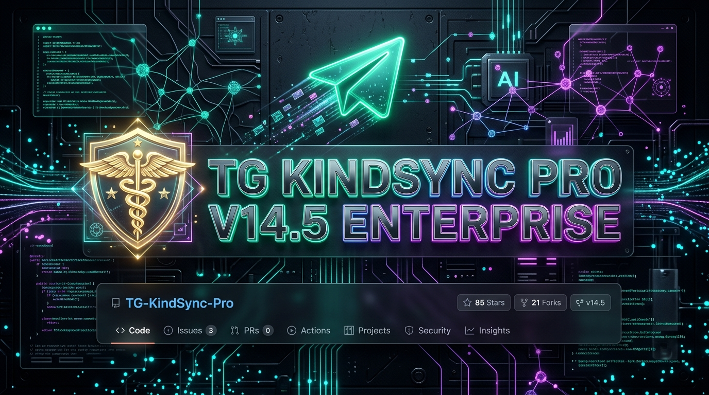
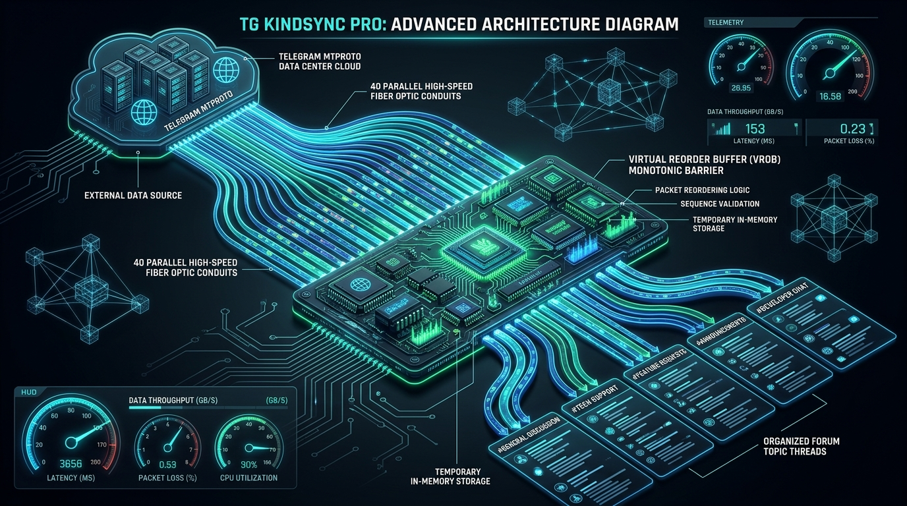
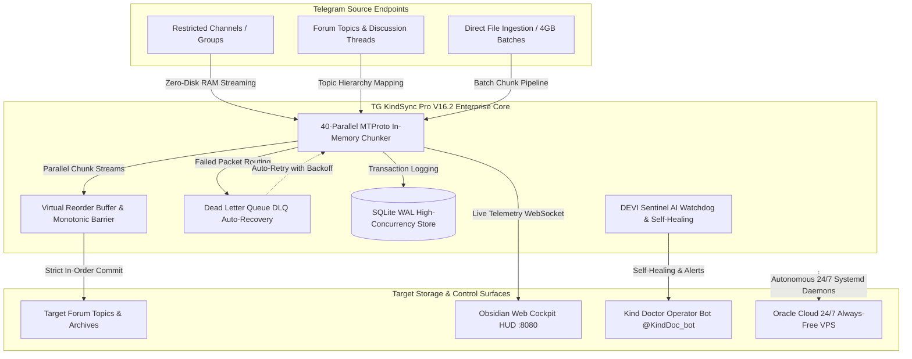
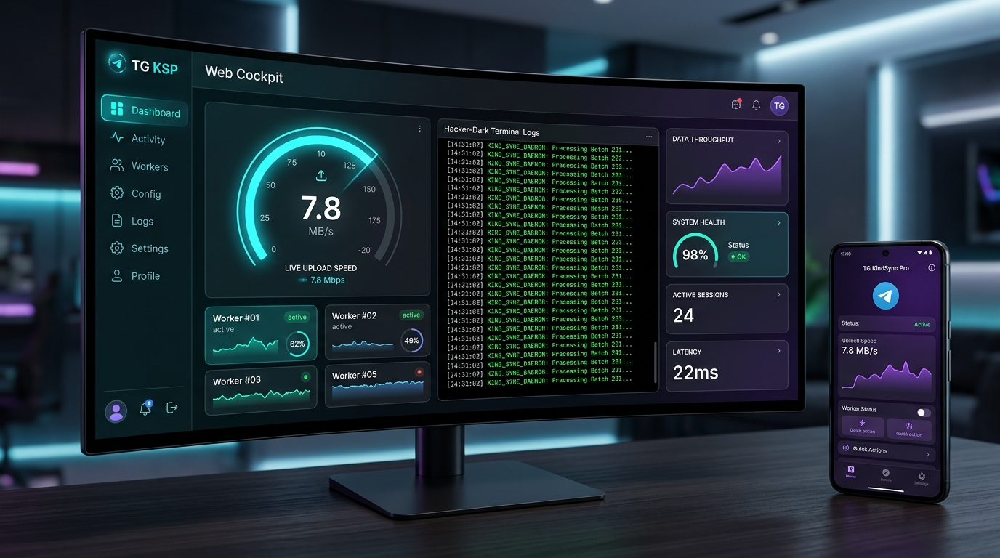
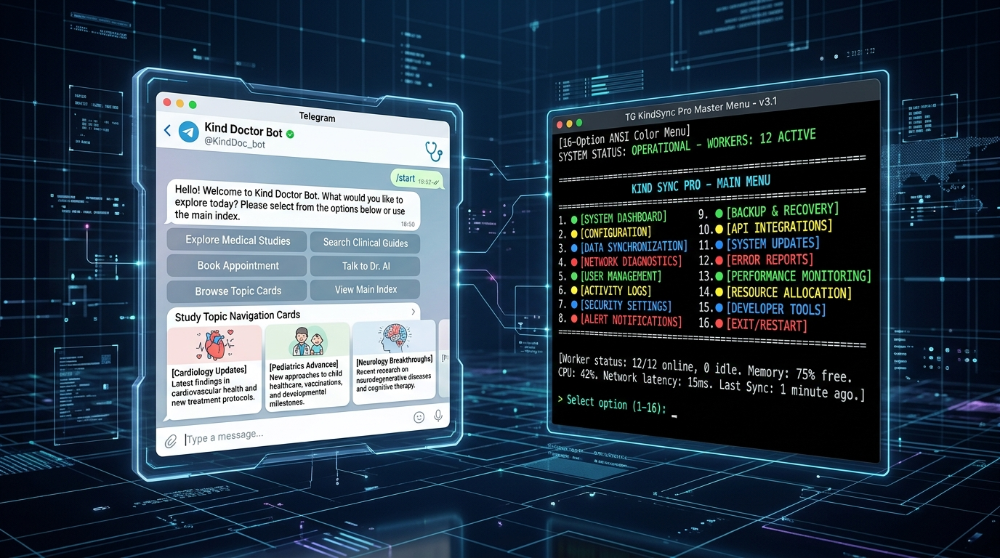

<div align="center">



# 🩺 TG KINDSYNC PRO — V16.2.0 ENTERPRISE TURBO MASTERPIECE
### *Autonomous Telegram MTProto In-Memory Streaming Suite • DEVI Sentinel Engine • 24/7 Multi-OS Cloud Infrastructure*

[](https://www.python.org/)
[](https://core.telegram.org/)
[](https://telegram.org/faq#telegram-premium)
[](README.md)
[](README.md)
[](https://cloud.oracle.com/)
[-7B2CBF?style=for-the-badge&logo=telegram)](https://t.me/Kinddoctor4u)
[](https://t.me/be_as_kind)

---

**Lead Developer & Systems Architect**: Dr. Amit Singh (Kind Doctor)  
**Permanent Super-Admins**: [`@Kinddoctor4u`](https://t.me/Kinddoctor4u) (ID: `1553619403`) & [`@Ammitrajput1`](https://t.me/Ammitrajput1) (ID: `759038032`)  
**Official Community & Bot**: [**Kind Doctor & Team**](https://t.me/be_as_kind) • [**@KindDoc_bot**](https://t.me/KindDoc_bot)

---

[🚀 Quick Start](#-quick-start--step-by-step-installation) · [🏗️ Architecture](#-system-architecture--data-flow) · [⚡ Speed & VROB](#-telegram-premium-4gb-uploads--40-socket-mtproto-wire-speed) · [🖥️ Web Cockpit](#-obsidian-cyber-glass-web-command-center--tma-20-port-8080) · [🤖 Bot Commands](#-kind-doctor-telegram-operator-bot-kinddoc_bot) · [🩺 Clinical CDSS](#-clinical-decision-support-system-cdss-studio) · [🔧 Troubleshooting](#-troubleshooting--common-fixes)

</div>

---

## 🛡️ Standalone Architecture & Independence Declaration

> [!IMPORTANT]
> **100% Autonomous MTProto Architecture — Zero Third-Party Client Dependencies**  
> **TG KindSync Pro** is an independent Telegram migration, forum cloning, and synchronization engine built from scratch in Python on native **Telegram MTProto Client Protocol (Telethon)**.
> - **No Third-Party Client Forks Required**: Does **NOT** require modified desktop or mobile Telegram builds.
> - **Bypasses 50MB Bot API Limits**: Streams 2GB (Standard) and **4GB (Telegram Premium)** files directly from restricted/copy-protected channels via cryptographic MTProto RPC.
> - **Zero-Disk In-Memory Streaming**: Streams chunks directly in RAM with real-time anti-DMCA caption sanitization, custom 16:9 thumbnail injection, and strict chronological ordering.

---

## 🚀 Quick Start & Step-by-Step Installation

Choose your platform below. **Everything runs 100% locally on your own device with your own Telegram account — no private keys or server access needed!**

---

### 💻 1. Windows 10 / 11 PC Setup (Step-by-Step)

#### Step 1: Install Prerequisites *(Skip if already installed)*
Open **PowerShell** (or Command Prompt) and run:
```powershell
winget install -e --id Git.Git
winget install -e --id Python.Python.3.12
```
> *Tip: If installing Python manually from [python.org](https://www.python.org/), check **`☑ Add python.exe to PATH`**. Close and reopen your terminal after installation.*

#### Step 2: Download (Clone) Repository
```powershell
git clone https://github.com/Ammitrajput01/TG_KindSync_Pro.git
cd TG_KindSync_Pro
```

#### Step 3: 1-Click Auto-Setup & Launch
Double-click **`1_START_PRO.bat`** in the folder:
- **Press `1`** — Automatically creates `.venv`, installs `requirements.txt`, copies `.env.example` ➔ `.env`, and launches the engine.
- **Press `4`** — Starts the **Local Web Dashboard** at `http://127.0.0.1:8080` *(Default Login: `Amit` / `Amit@123`)*.

#### Step 4: Instant 3-Way Telegram Login *(No Manual `.env` Editing Needed!)*
When launched, choose any login method directly in the wizard:
1. **⚡ Method 1: Instant QR Code Scan (Fastest)** — Scan the terminal QR code via `Telegram App ➔ Settings ➔ Devices ➔ Link Desktop Device`.
2. **📱 Method 2: Phone OTP & 2FA** — Enter your phone number (`+91...`), Telegram login code, and 2FA password.
3. **🌐 Method 3: Browser Web Login (`:5005`) & Cockpit (`:8080`)** — Use the Web Login portal (`http://127.0.0.1:5005`) to link your Telegram account, and monitor transfers in the Obsidian Web Cockpit (`http://127.0.0.1:8080`).

#### Step 5: Update to Latest GitHub Version Anytime
```powershell
git pull origin main
.\.venv\Scripts\python.exe -m pip install -r requirements.txt
```

#### Windows Launchers Reference
| Launcher File | Role | Description |
|:---|:---:|:---|
| **[`1_START_PRO.bat`](1_START_PRO.bat)** | ⚡ **Master Control** | Main 1-click launcher (Engine setup, Local Web Dashboard, Health Check). |
| **[`2_START_KIND_DOCTOR_BOT.bat`](2_START_KIND_DOCTOR_BOT.bat)** | 🩺 **Operator Bot** | Starts the standalone `@KindDoc_bot` daemon locally. |
| **[`3_START_WEB_DASHBOARD.bat`](3_START_WEB_DASHBOARD.bat)** | 📊 **Web Cockpit** | Starts the Obsidian Web Dashboard at `http://localhost:8080`. |

---

### 📱 2. Android Phone & Tablet Setup (Termux — No Root Needed)

> [!IMPORTANT]
> **Install Termux from [F-Droid](https://f-droid.org/packages/com.termux/)** *(Do NOT use the outdated Google Play Store build).*

#### ⚡ Option A: 1-Line All-In-One Install (Copy & Paste in Termux)
```bash
pkg update -y && pkg upgrade -y && pkg install -y git python python-psutil python-pillow python-cryptography openssl && git config --global http.version HTTP/1.1 && git config --global http.postBuffer 524288000 && git clone --depth 1 https://github.com/Ammitrajput01/TG_KindSync_Pro.git && cd TG_KindSync_Pro && cp -n .env.example .env && pip install --break-system-packages -r requirements-termux.txt
```

#### 📋 Option B: Step-by-Step Manual Setup
1. **Update Termux & Install System Packages**:
   ```bash
   pkg update -y
   pkg install -y git python python-psutil python-pillow python-cryptography openssl
   ```
2. **Clone Repository**:
   ```bash
   git config --global http.version HTTP/1.1
   git config --global http.postBuffer 524288000
   git clone --depth 1 https://github.com/Ammitrajput01/TG_KindSync_Pro.git
   cd TG_KindSync_Pro
   cp -n .env.example .env
   ```
3. **Install Android-Safe Python Dependencies**:
   ```bash
   pip install --break-system-packages -r requirements-termux.txt
   ```
4. **Launch & Log In**:
   ```bash
   bash 1_START_KINDSYNC.sh
   ```

#### Android Launchers & 1-Click Update
| Script | Command | Purpose |
|:---|:---|:---|
| **Start Engine** | `bash 1_START_KINDSYNC.sh` | Starts Forwarder, Cloner, Indexer & QR Login |
| **Start Web Dashboard** | `bash 3_START_WEB_DASHBOARD.sh` | Opens Web Dashboard at `http://127.0.0.1:8080` |
| **24/7 Screen-Off Mode** | `bash 4_START_24_7_AUTOPILOT.sh` | Runs Forwarder + Bot + Dashboard with Wake-Lock |
| **1-Click GitHub Update** | `bash 5_UPDATE_KINDSYNC.sh` | Pulls latest GitHub fixes & updates packages safely |
| **Mobile Master Menu** | `bash 1_START_TERMUX.sh` | Full interactive 8-option Termux menu |

> [!TIP]
> **Prevent Android Sleep**: Go to `Android Settings ➔ Apps ➔ Termux ➔ Battery ➔ Unrestricted`, and run `termux-wake-lock` when running long clones.

---

### 🐧 3. Linux / Ubuntu / Oracle Cloud VPS (24/7 Server Setup)

#### Step 1: Install System Packages
```bash
sudo apt update && sudo apt install -y \
    python3 python3-pip python3-venv git ffmpeg libgl1 fonts-dejavu-core tmux curl
```

#### Step 2: Clone & Setup Virtual Environment
```bash
git clone https://github.com/Ammitrajput01/TG_KindSync_Pro.git
cd TG_KindSync_Pro
python3 -m venv .venv
source .venv/bin/activate
pip install --upgrade pip
pip install -r requirements.txt
cp -n .env.example .env
```

#### Step 3: Run 24/7 with `systemd` (Optional Server Daemons)
```bash
sudo systemctl enable tg-forwarder tg-kinddoc-bot tg-dashboard tg-sentinel
sudo systemctl start tg-forwarder tg-kinddoc-bot tg-dashboard tg-sentinel
sudo systemctl status tg-forwarder tg-kinddoc-bot --no-pager
```

> *Optional 1-Command Deploy / Docker*: Run `bash deploy/deploy.sh` for automated `systemd` provisioning, or `docker compose up -d` using the included [`Dockerfile`](Dockerfile) and [`docker-compose.yml`](docker-compose.yml).

---

## 🏗️ System Architecture & Data Flow

<div align="center">


*Figure 1: High-Speed MTProto Data Center Ingress, 40-Socket Concurrency Pipeline, Virtual Reorder Buffer (VROB) & Forum Hierarchy Dispatcher.*

</div>



---

## 🌟 Core Capabilities & Highlights

1. **Telegram Premium 4GB Streaming**: Unlocks up to 4GB single-file uploads for Telegram Premium accounts with zero disk staging, bypassing the standard 2GB ceiling.
2. **40-Socket Chunk Parallelism (God Mode)**: Opens up to 40 concurrent TCP upload chunk sockets per multipart file stream for maximum throughput.
3. **Deterministic Sequence Locking (VROB)**: Monotonic Sequence Barrier guarantees lecture series and PDFs always arrive in strict chronological order even at `MESSAGE_DELAY=0.0s`.
4. **Restricted Content Streaming**: Streams media from copy-protected channels, private groups, and forum topics directly through RAM.
5. **Smart Old-Index Filtering**: Automatically skips stale source index/table-of-contents cards during cloning so your target topics stay clean.
6. **Obsidian Cyber-Glass Web Cockpit (`:8080`)**: Real-time speedometer gauge, live terminal stream, **Live Cloner Jobs Pause/Resume/Stop**, mobile drawer, and 1-click SQLite snapshots.
7. **Kind Doctor Bot (`@KindDoc_bot`) & DEVI AI Sentinel**: Interactive menu (`/menu`), live auto-indexing during `/clone`, in-place pinned index updates (`/mainindex`, `/topicindex`), YouTube/Instagram uploader (`/ytdl`, `/upload`), SangMata OSINT (`/whois`), and `sentinel_observer.py` self-healing alerts.
8. **Permanent Vault Architecture (Zero Deletion Sync)**: Source deletions or takedowns never propagate to your target backup group.
9. **Anti-DMCA Symbol Obfuscation (`strip_words.txt`)**: Built-in replacement engine for 50+ study platforms plus custom watermark/promo removal.

---

## ⚡ Telegram Premium 4GB Uploads & 40-Socket MTProto Wire Speed

| Metric / Parameter | Standard Telegram Accounts | Telegram Premium Account | Engineering Advantage |
| :--- | :---: | :---: | :--- |
| **Max File Upload Size** | 2,000 MB (2.0 GB) | **4,096 MB (4.0 GB)** | Complete 4K lectures stream without truncation. |
| **Chunk Upload Parallelism** | 12 Concurrent Sockets | **40 Concurrent Sockets** | Parallel chunk upload sockets saturate fiber/VPS pipes. |
| **Transmission Pacing Delay** | 0.2s Safe Delay | **0.0s (Uncapped)** | Zero artificial sleep between packets when in God Mode. |
| **Dead-Letter Guard** | Files > 2GB routed to DLQ | **Auto-Bypasses 2GB Ceiling** | `tg_kindsync_pro.py` streams in-RAM up to 2GB; `deep_cloner.py` uses Tier 1 (<100MB RAM) & Tier 2 (temp chunked cache for >100MB) + `upload.saveBigFilePart`. |

### Virtual Reorder Buffer (VROB) In-Order Guarantee
```
Source Messages:   [ Msg 101 ] ──► [ Msg 102 ] ──► [ Msg 103 ]
                         │               │               │
Concurrent Workers: Worker A (4.2s)  Worker B (1.1s)  Worker C (2.8s)
                         │               │               │
VROB Barrier:      Holds #102 & #103 until #101 commits ──► Releases #101 ➔ #102 ➔ #103
```

---

## 🖥️ Obsidian Cyber-Glass Web Command Center & TMA 2.0 (Port 8080)

<div align="center">


*Figure 2: Obsidian Cyber-Glass Web Command Center HUD (Desktop) & Telegram Mini App 2.0 Interface (Mobile).*

</div>

- **Collapsible Icon-Rail Sidebar (`Ctrl+B`)**: Clean 70px rail with floating dark-blur tooltips.
- **Live Telemetry & Speedometer**: Real-time upload velocity gauge, 60-second bandwidth graph, and WebSocket terminal logs (`/ws/terminal_logs`).
- **Hardened Multi-Tenant Security**: Local auto-unlock is restricted strictly to loopback (`127.0.0.1` / `::1`); remote visitors authenticate via PBKDF2-HMAC-SHA256 or Telegram Mini App `HMAC-SHA256`.

---

## 🤖 Kind Doctor Telegram Operator Bot (`@KindDoc_bot`)

<div align="center">


### **Kind Doctor Bot (`@KindDoc_bot`)**
*Your All-in-One Study Assistant • Official Live Telegram Bot*



</div>

### Bot Commands Reference

| Command | Permission | Operational Description |
|:---|:---:|:---|
| `/start` / `/menu` | Public | Welcome screen and interactive 10-card feature menu. |
| `/mainindex` | Public | Builds clickable A–Z Master Topic Directory and auto-pins it. |
| `/topics` | Public | Alphabetical topic catalog with quick jump links. |
| `/topicindex [id]` | Public | Generates clickable lecture & PDF index inside the current or specified topic. |
| `/scan` | Admin | Auto-scans group forum topics and media into SQLite index. |
| `/calc` | Public | Clinical Decision Studio: Parkland, GCS, eGFR, BMI, and OpenFDA Drug KB. |
| `/ytdl [url]` / `/playlist [url]` | Public | Downloads YouTube video/playlist and uploads directly inside current Forum Topic. |
| `/upload [url]` | Public | Universal uploader for Instagram Reels, Twitter/X, TikTok, and web files. |
| `/clone [src] [tgt]` | Admin | 1-Click Deep Cloner for forum groups, topics, or message ranges. |
| `/clonestatus` / `/stopclone` | Admin | Live cloning progress, pause/resume, and stop controls. |
| `/connect` / `/autoforward` | Admin | Link your Telegram account in DM, view live routes, and control pipeline. |
| `/pacing` | Admin | 1-Click delay presets (`0.0s` Supersonic to `2.0s` Stealth). |
| `/stripwords` / `/syncstrip` | Admin | View/manage Anti-DMCA word replacements and sync `strip_words.txt` to SQLite. |
| `/userinfo [id/@user]` | Admin | SangMata OSINT radar: name/username history and risk score. |
| `/members` / `/dailymembers` / `/strikebackup` | Admin | Member audit, IST daily joins report, and emergency strike CSV/JSON backup. |
| `/cleandeleted` / `/newtopic [name]` | Admin | Purge deleted ghost accounts, create forum topics, or switch target group (`/setgroup`). |
| `/status` / `/engine` / `/polyglot` / `/backup` | Admin | System vitals, Polyglot native acceleration matrix, and timestamped SQLite snapshot. |

---

## 🩺 Clinical Decision Support System (CDSS) Studio

<div align="center">


*Figure 3: Bedside Clinical Decision Studio: Parkland 4-2-1 Burn Calculator, GCS Neuro-Wheel, and OpenFDA Drug Interaction Matrix.*

</div>

- **Parkland 4-2-1 Burn Fluid Calculator**: Calculates 24h Ringer's Lactate volume ($4\text{ mL} \times \text{kg} \times \%\text{TBSA}$) and 8h / 16h split rates.
- **Glasgow Coma Scale (GCS)**: Eye, Verbal, and Motor scoring with automatic severity grading.
- **eGFR CKD-EPI & OpenFDA Drug KB**: Race-agnostic renal dosing + FDA monographs & Drug-Drug Interaction (DDI) Radar.

---

## 📋 21-Option CLI Menu Matrix

| Quadrant | Options | Key Capabilities |
|:---|:---:|:---|
| **1. Transmission** | `1–4` | Safe Mode (4 sockets), Balanced (12), God Mode (40), Live 24/7 Listener |
| **2. Routing & Index** | `5–8` | Quick Link Extractor, Multi-Route Manager, Content Cloner, Topic Indexer |
| **3. Media Studio** | `9–12` | Folder 4GB Uploader, Caption & Strip Studio, 16:9 Cover Enforcer, DLQ Recovery |
| **4. System & Tools** | `13–21` | Diagnostics, Reset History, Cleaner, Safe Exit, Mode Toggles, Updater, Multi-Account, Polyglot Matrix, DEVI AI |

---

## 🔧 Troubleshooting & Common Fixes

| Issue | Cause & Instant Fix |
|:---|:---|
| **Android crash: `PermissionError: '/proc/stat'`** | Fixed in latest commit (`b3a1b8a`). Run `bash 5_UPDATE_KINDSYNC.sh` in Termux to update. |
| **Android `5_UPDATE_KINDSYNC.sh` failing on pip** | Fixed in latest commit. If updating from an older build, run `git pull origin main && bash 5_UPDATE_KINDSYNC.sh`. |
| **Windows: `python` or `git` not recognized** | Run `winget install -e --id Git.Git` and `winget install -e --id Python.Python.3.12`, then reopen terminal. |
| **Web Dashboard `127.0.0.1:8080` not opening** | Use **`1_START_PRO.bat` ➔ Option `4`** (auto-starts local `web_dashboard.py`) or double-click `3_START_WEB_DASHBOARD.bat`. |
| **Cloner shows `Messages` count rising while `Sent Out: 0`** | Source channel starts with empty/service/deleted stub messages; real media begins streaming automatically once stubs are passed. |

---

## 🔒 Security, Privacy & Multi-Tenant Isolation

1. **Zero Credential Tracking**: `.env`, `*.session`, `*.sqlite`, `*.key`, and `data/` are permanently excluded in `.gitignore`.
2. **Super-Admin Verification**: Master controls and OSINT relays are strictly locked to `@Kinddoctor4u` (`1553619403`) & `@Ammitrajput1` (`759038032`).
3. **Lock-Free SQLite WAL**: High-concurrency `WAL` mode eliminates database lock contention across concurrent workers.

---

## 👑 Credits & Verified Official Contacts Directory

<div align="center">


### **Dr. Amit Singh (Kind Doctor)**
**Lead Developer, Systems Architect & Founder**  
[**Kind Doctor & Team**](https://t.me/be_as_kind) • [**@KindDoc_bot**](https://t.me/KindDoc_bot)

</div>

> [!CAUTION]
> **Anti-Impersonation Notice**: Only the accounts listed below are authentic. Never share your `.env`, `.session` files, OTPs, or API keys with anyone.

| Contact Role | Platform | Verified Handle / ID | Direct Link | Status |
|:---|:---:|:---:|:---:|:---:|
| **Primary Super-Admin 1** | Telegram | `@Kinddoctor4u` *(ID: `1553619403`)* | [t.me/Kinddoctor4u](https://t.me/Kinddoctor4u) | ✅ **Active Verified** |
| **Primary Super-Admin 2** | Telegram | `@Ammitrajput1` *(ID: `759038032`)* | [t.me/Ammitrajput1](https://t.me/Ammitrajput1) | ✅ **Active Verified** |
| **Official Community** | Telegram | `Kind Doctor & Team` | [t.me/be_as_kind](https://t.me/be_as_kind) | ✅ **Official Channel** |
| **Kind Doctor Bot Daemon** | Telegram | `@KindDoc_bot` | [t.me/KindDoc_bot](https://t.me/KindDoc_bot) | 🤖 **24/7 Live Bot** |
| **Official Instagram** | Instagram | `@ammmitrajput1` | [instagram.com/ammmitrajput1](https://www.instagram.com/ammmitrajput1) | ✅ **Official Profile** |
| **Direct Inquiries** | Email | `Ammitrajput1@gmail.com` | [mailto:Ammitrajput1@gmail.com](mailto:Ammitrajput1@gmail.com) | ✅ **Official Inbox** |

<div align="center">
<sub>© 2026 TG KindSync Pro Enterprise. Handcrafted with pride by Dr. Amit Singh (Kind Doctor).</sub>
</div>
