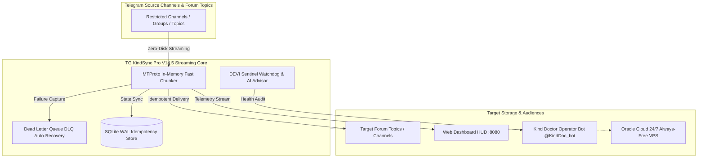

<div align="center">


# 🩺 TG KINDSYNC PRO — V14.5 ENTERPRISE MASTERPIECE
### *High-Velocity Telegram In-Memory Streaming Suite • DEVI AI Sentinel • 24/7 Oracle Cloud Engine*

[](https://www.python.org/)
[](https://core.telegram.org/)
[](https://cloud.oracle.com/)
[](LICENSE)
[-purple?style=for-the-badge&logo=telegram)](https://t.me/Kinddoctor4u)
[](https://t.me/Ammitrajput1)

---

**Lead Developer & Architect**: Dr. Amit Singh (Kind Doctor)  
**Permanent Super-Admins**: [`@Kinddoctor4u`](https://t.me/Kinddoctor4u) (ID: `1553619403`) & [`@Ammitrajput1`](https://t.me/Ammitrajput1) (ID: `759038032`)  
**Community / Public Branding**: **Kind Doctor & Team** • **Group Study Help 😉**

</div>

---

## 🌟 Executive Summary & System Overview

**TG KindSync Pro V14.5** is a proprietary, enterprise-grade Telegram streaming, auto-synchronization, and content migration core. Built with custom high-speed MTProto in-memory pipelining, it is engineered to bypass forward and copy restrictions without saving files to disk, preserving topic hierarchies, injecting dynamic watermarking/captions, and running 24/7 non-stop across Windows, Linux, Android (Termux), and Oracle Cloud VPS.

---

## 🖥️ Live Web Command Center HUD (Port 8080)

<div align="center">


*Real-time streaming telemetry, upload speed gauges, SQLite WAL latency monitors, active worker status cards, and live log stream.*

</div>

### 🔑 Web Dashboard Key Features
- **Multi-User RBAC Security**: Built-in User Management (Admin & Operator roles) with SHA256 password hashing.
- **In-Browser Telegram Account Manager**: Direct OTP & 2FA Cloud Password login from web UI.
- **Speedometer Velocity HUD**: Live speed meter (MB/s), packet delivery rate, and active file stream bar.
- **DEVI Autonomous Research Hub**: Real-time AI insights, alerts, and system health advisories.
- **1-Click Cloud Backups & DLQ Engine**: Instant database snapshot export and dead-letter failure retry.

---

## 🤖 Kind Doctor Telegram Operator Bot (`@KindDoc_bot`) & Terminal Interface

<div align="center">


*Interactive Topic Navigation Cards (`/mainindex`), Medical Study Relays, and 19-Option ANSI Terminal CLI.*

</div>

---

## ⚡ Core Capabilities & Architecture



---

## 📋 Comprehensive 19-Option CLI Menu Matrix

The terminal interface is structured into four distinct, high-performance operational quadrants:

### 1. Transmission Quadrant (Streaming & Forwarding)
| Option | Module Name | Workers | Description |
|:---|:---|:---:|:---|
| **1** | 🟢 **Safe Mode** | 4 | Anti-FloodWait rate-limited streaming for sensitive accounts & low-bandwidth networks. |
| **2** | ⚖️ **Balanced Mode** | 12 | **Default recommended production mode**. Optimal throughput with adaptive rate pacing. |
| **3** | 🔥 **God Mode** | 40 | Turbo parallel in-memory chunking for Gigabit connections & massive libraries. |
| **4** | 🔴 **Live 24/7 Mode** | 12 | Continuous real-time message listener & instant forwarder daemon. |

### 2. Routing & Topic Studio Quadrant
| Option | Module Name | Description |
|:---|:---|:---|
| **5** | 🔗 **Quick Link Extractor** | Fast configuration wizard to set Source and Target channel IDs / links in `.env`. |
| **6** | 🔀 **Multi-Route Manager** | Visual mapping table for complex multi-channel and multi-topic routing matrices. |
| **7** | 🎯 **Content Cloner & Cherry-Picker** | **[1]** Direct Single/Specific Video Forwarder, **[2]** Content Cherry-Picker, **[3]** Member Scraper & Smart Adder, **[4]** Full Group/Forum Auto-Mirror. |
| **8** | 📑 **Topic & Group Indexer** | Generates master clickable table of contents (TOC) for entire forums and topic file indices. |

### 3. Media & Optimization Studio Quadrant
| Option | Module Name | Description |
|:---|:---|:---|
| **9** | 📁 **Folder Batch & 2GB Uploader** | Disk file batch uploader with auto-tags, video splitting, and sequence enforcement. |
| **10** | ✍️ **Caption & Link Studio** | Dynamic emoji tags, header/footer branding, and URL replacement engine. |
| **11** | 🖼️ **16:9 Cover Enforcer** | Custom video thumbnail injector and 16:9 aspect ratio standardizer. |
| **12** | 📮 **DLQ Auto-Recovery** | Dead Letter Queue failure manager: 1-Click Auto-Retry, JSON Export, and Purge. |

### 4. Diagnostics, Maintenance & System Tools
| Option | Module Name | Description |
|:---|:---|:---|
| **13** | 🩺 **System Diagnostics** | Network latency test, MTProto connection health, and SQLite integrity check. |
| **14** | ♻️ **Reset History & Database** | Clean slate database rebuild allowing re-syncing from message #1. |
| **15** | 🧹 **Advanced Cleaner & Purge** | Flushes stale locks, temporary sessions, and orphaned cache files safely. |
| **16** | ❌ **Safe Exit** | Flushes SQLite WAL buffers to disk and executes zero-data-loss graceful shutdown. |
| **17** | ⚙️ **Mode Toggles** | Toggle between Pure Deterministic and DEVI AI Assisted operating modes. |
| **18** | 🔄 **1-Click Auto-Updater** | Pulls latest core updates while 100% protecting `.env`, sessions, and database. |
| **19** | 👥 **Multi-Account Switcher** | Switch active forwarding sessions on-the-fly without restarting. |

---

## 🤖 Kind Doctor Telegram Bot (`@KindDoc_bot`) Commands

| Command | Access Level | Description |
|:---|:---:|:---|
| `/start` | Public / Admin | Welcome screen, help menu, and interactive feature navigation. |
| `/mainindex` | Public / Admin | Interactive Study Category Cards with inline buttons and page scrolling. |
| `/topics` | Public / Admin | Alphabetical topic navigator with search and quick jump. |
| `/topicindex` | Public / Admin | Generates direct links to all messages inside a specific topic. |
| `/status` | Admin | Real-time system health, uptime, memory, and active forwarding status. |
| `/stats` | Admin | Total messages forwarded, media breakdown, speed metrics, and errors. |
| `/speed` | Admin | Current throughput velocity and MTProto worker latency. |
| `/backup` | Admin | Triggers full SQLite database and configuration backup with full timestamp. |
| `/restart` | Admin | Gracefully restarts the background forwarder and bot daemons. |

---

## 🚀 1-Click Launchers Suite

| Launcher File | Mode | Description |
|:---|:---:|:---|
| **[`DEPLOY_ORACLE.bat`](DEPLOY_ORACLE.bat)** | 🚀 **Push & Deploy** | Pushes commits to Private GitHub & deploys live to Oracle Cloud VPS in 1 click. |
| **[`1_START_ALL.bat`](1_START_ALL.bat)** | ⚡ **Master Launcher** | Launches Forwarder Engine + Kind Doctor Bot + Web Dashboard simultaneously. |
| **[`START_TABBED.bat`](START_TABBED.bat)** | 🌐 **Tabbed Terminal** | Runs all services inside unified Windows Terminal tabs. |
| **[`START_KIND_DOCTOR_BOT.bat`](START_KIND_DOCTOR_BOT.bat)** | 🩺 **Kind Doctor Bot** | Standalone Telegram operator bot daemon (`@KindDoc_bot`). |
| **[`3_START_DEVI_DASHBOARD.bat`](3_START_DEVI_DASHBOARD.bat)** | 📊 **Web Dashboard** | Starts live command center on `http://localhost:8080`. |
| **[`UPDATE_KINDSYNC.bat`](UPDATE_KINDSYNC.bat)** | 🔄 **Safe Auto-Updater** | Pulls latest code safely while protecting local sessions. |

---

## ☁️ Oracle Cloud Always-Free VPS Architecture (24/7 Zero-Downtime)

TG KindSync Pro is architected to run permanently on Oracle Cloud Ubuntu 24.04 LTS instances:

```text
/etc/systemd/system/
├── tg-forwarder.service    (TG KindSync Pro Live Streaming Engine)
├── tg-kinddoc-bot.service  (Kind Doctor Telegram Operator Bot Daemon)
└── tg-dashboard.service    (DEVI Web Command Center on Port 8080)
```

### VPS Management Commands:
```bash
# Restart all 3 services
sudo systemctl restart tg-forwarder tg-kinddoc-bot tg-dashboard

# Check live service status
sudo systemctl status tg-kinddoc-bot --no-pager

# View real-time forwarder logs
sudo journalctl -u tg-forwarder -f
```

---

## 🔒 Security, Privacy & Zero-Leak Shield

TG KindSync Pro implements strict enterprise asset isolation:
1. **Never Tracked in Git**: All `.env`, `*.session`, `*.sqlite`, `*.key`, and `data/` credentials are permanently protected in `.gitignore`.
2. **Deterministic Locking**: Prevents concurrent duplicate database write collisions via `engine.lock` and SQLite WAL journaling.
3. **Admin Verification**: All master bot controls and sensitive diagnostic relays strictly check Telegram user IDs against permanent admins:
   - Primary 1: `@Kinddoctor4u` (ID: `1553619403`)
   - Primary 2: `@Ammitrajput1` (ID: `759038032`)

---

## 📚 Official Guides & Documentation

- 📖 **Complete User Manual**: [`docs/SETUP_GUIDE_AND_MANUAL.md`](docs/SETUP_GUIDE_AND_MANUAL.md)
- 🤖 **Bot Setup & Command Guide**: [`docs/BOT_GUIDE_AND_COMMANDS.md`](docs/BOT_GUIDE_AND_COMMANDS.md)
- ☁️ **Oracle Cloud 24/7 VPS Deployment**: [`deploy/ORACLE_CLOUD_DEPLOY_GUIDE.md`](deploy/ORACLE_CLOUD_DEPLOY_GUIDE.md)
- 📱 **Android Termux 24/7 Setup**: [`docs/TERMUX_GUIDE.md`](docs/TERMUX_GUIDE.md)

---

## 👑 Credits & Official Contacts

- **Creator & Lead Developer**: **Dr. Amit Singh (Kind Doctor)**
- **Telegram Primary 1**: [@Kinddoctor4u](https://t.me/Kinddoctor4u) (ID: `1553619403`)
- **Telegram Primary 2**: [@Ammitrajput1](https://t.me/Ammitrajput1) (ID: `759038032`)
- **Instagram**: [@ammmitrajput1](https://www.instagram.com/ammmitrajput1)
- **Email**: `Ammitrajput1@gmail.com`
- **Branding**: **Kind Doctor & Team** • **Group Study Help 😉**

<div align="center">
<sub>© 2026 TG KindSync Pro Enterprise. Handcrafted with pride by Dr. Amit Singh.</sub>
</div>
