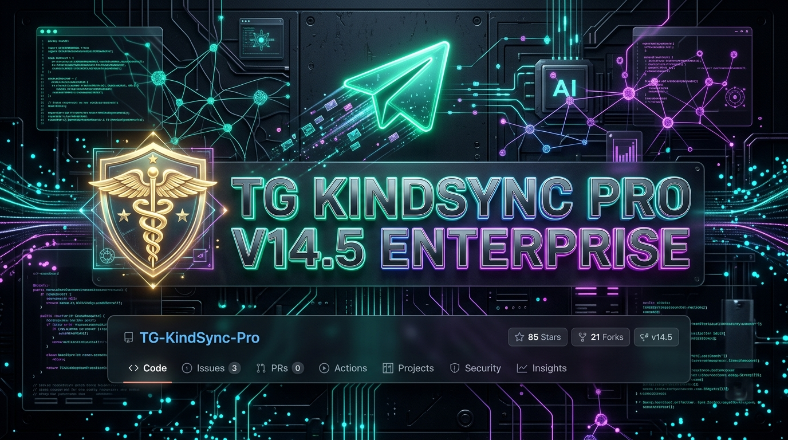
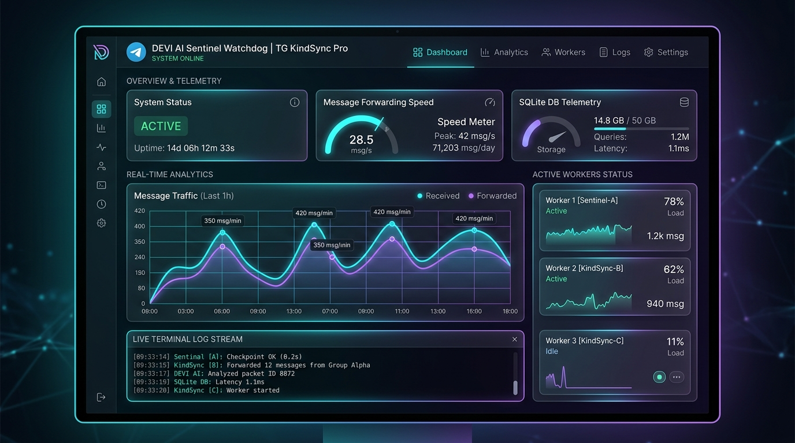
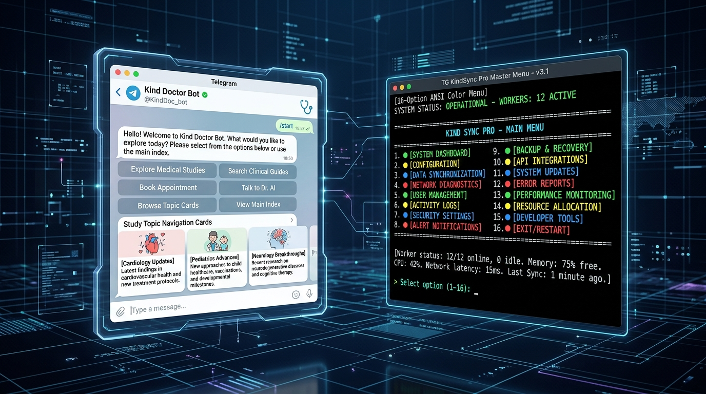

# 🩺 TG KINDSYNC PRO — V14.5 ENTERPRISE MASTERPIECE
### *High-Velocity Telegram Streaming Suite • Ayugram Turbo (Up to 4GB) • DEVI AI Sentinel • 24/7 Oracle Cloud Engine*

[-purple?style=for-the-badge&logo=telegram)](https://t.me/Kinddoctor4u)

---

**Lead Developer & Architect**: Dr. Amit Singh (Kind Doctor)  
**Permanent Super-Admins**: [`@Kinddoctor4u`](https://t.me/Kinddoctor4u) & [`@Ammitrajput1`](https://t.me/Ammitrajput1)  
**Community / Public Branding**: **Kind Doctor & Team** • **Group Study Help 😉**

---

## 🌟 Executive Overview

**TG KindSync Pro V14.5** is the industry standard for high-performance Telegram channel/group synchronization, multi-topic forum cloning, Ayugram 4GB ultra-streaming, and automated content preservation.

Built with high-speed MTProto in-memory chunking, TG KindSync Pro seamlessly bypasses forward & copy restrictions, maintains topic hierarchies, injects smart custom captions, and runs non-stop 24/7 locally or on Oracle Cloud Always-Free VPS instances.

---

## 🖥️ Live Web Dashboard HUD (Port 8080)

*Real-time streaming telemetry, worker latency gauges, live terminal logs, and SQLite database health.*

---

## 🤖 Kind Doctor Bot (`@KindDoc_bot`) & Terminal Interface

*Interactive Topic Index Cards (`/mainindex`), Medical Study Relays, and 16-Option Color Terminal CLI.*

---

## ⚡ Key Highlights & Enterprise Architecture

- 🚀 **Ayugram Turbo Streaming (Up to 4GB)**: Zero-disk in-memory direct piping for massive files, lectures, and media.
- 🩺 **Kind Doctor Bot Daemon (`@KindDoc_bot`)**: Real-time topic navigation (`/mainindex`, `/topics`), admin relays, and user support routing.
- 🛡️ **DEVI Autonomous AI Sentinel**: Continuous anomaly detection, FloodWait auto-recovery, and smart self-healing.
- 🧬 **Forum & Topic Cloner**: Replicates complete forum structures, nested topics, and permissions with 1 click.
- ☁️ **Oracle Cloud 24/7 Always-Free VPS**: Pre-configured systemd services (`tg-forwarder`, `tg-kinddoc-bot`, `tg-dashboard`) for zero-downtime execution.
- 🔒 **Zero-Leak Protection Barrier**: Built-in credential isolation protecting `.session`, `.env`, and production SQLite databases.

---

## 🚀 1-Click Launchers Suite

| Launcher | Name | Purpose |
| :--- | :--- | :--- |
| **[`DEPLOY_ORACLE.bat`](DEPLOY_ORACLE.bat)** | 🚀 **1-Click Push & Deploy** | Pushes to Private GitHub & deploys live to Oracle Cloud VPS in 1 click |
| **[`1_START_ALL.bat`](1_START_ALL.bat)** | ⚡ **Master Launcher** | Launches Forwarder Engine + Kind Doctor Bot + Web Dashboard |
| **[`START_TABBED.bat`](START_TABBED.bat)** | 🌐 **Tabbed Terminal** | Runs all services inside unified Windows Terminal tabs |
| **[`START_KIND_DOCTOR_BOT.bat`](START_KIND_DOCTOR_BOT.bat)** | 🩺 **Kind Doctor Bot** | Standalone Telegram operator bot daemon |
| **[`3_START_DEVI_DASHBOARD.bat`](3_START_DEVI_DASHBOARD.bat)** | 📊 **Web Dashboard** | Starts live HUD on `http://localhost:8080` |
| **[`UPDATE_KINDSYNC.bat`](UPDATE_KINDSYNC.bat)** | 🔄 **Safe Auto-Updater** | Pulls latest code safely while protecting local sessions |

---

## 📋 CLI 16-Option Master Architecture

| # | Category | Module Name | Description |
|:---|:---|:---|:---|
| **1** | Transmission | 🟢 Safe Mode | 4 Workers · Low bandwidth / anti-rate limit |
| **2** | Transmission | ⚖️ Balanced Mode | 12 Workers · Default recommended production speed |
| **3** | Transmission | 🔥 God Mode | 40 Workers · Gigabit turbo streaming |
| **4** | Transmission | 🔴 Live 24/7 Mode | Continuous real-time auto-forward daemon |
| **5** | Routing | 🔗 Link Extractor | Quick configuration of Source & Target channels |
| **6** | Routing | 🔀 Multi-Route Manager | Visual table for complex multi-topic and forum mapping |
| **7** | Routing | 🧬 Group/Forum Cloner | Full topic-by-topic automated forum replication |
| **8** | Routing | 📑 Topic & Group Indexer | Master Forum TOC & Single Topic Files Indexer |
| **9** | Studio | 📁 Batch Folder & 2GB Uploader | Auto-tags, split & sequence disk uploader |
| **10** | Studio | ✍️ Caption & Link Studio | Dynamic emoji, headers & custom branding engine |
| **11** | Studio | 🖼️ 16:9 Cover Enforcer | Video thumbnail generator & 16:9 aspect ratio standardizer |
| **12** | Studio | 🔄 DLQ Auto-Recovery | Dead-Letter Queue 1-click retry for failed items |
| **13** | System | 🩺 System Diagnostics | Ping, MTProto latency & SQLite integrity audit |
| **14** | System | ♻️ Reset History & DB | Clean slate database rebuild from message #1 |
| **15** | System | 🧹 Deep Cleaner & Purge | Safe cleanup of stale locks, cache & temp files |
| **16** | System | ❌ Safe Exit | Flushes SQLite WAL and performs clean shutdown |

---

## 📚 Comprehensive Guides & Documentation

- 📖 **Full Setup & User Manual**: [`docs/SETUP_GUIDE_AND_MANUAL.md`](docs/SETUP_GUIDE_AND_MANUAL.md)
- 🤖 **Telegram Bot Command Guide**: [`docs/BOT_GUIDE_AND_COMMANDS.md`](docs/BOT_GUIDE_AND_COMMANDS.md)
- ☁️ **Oracle Cloud Server Deployment**: [`deploy/ORACLE_CLOUD_DEPLOY_GUIDE.md`](deploy/ORACLE_CLOUD_DEPLOY_GUIDE.md)
- 📱 **Android Termux 24/7 Guide**: [`docs/TERMUX_GUIDE.md`](docs/TERMUX_GUIDE.md)

---

## 👑 Credits & Official Contacts

- **Creator & Lead Developer**: **Dr. Amit Singh (Kind Doctor)**
- **Telegram Primary 1**: [@Kinddoctor4u](https://t.me/Kinddoctor4u) (ID: `1553619403`)
- **Telegram Primary 2**: [@Ammitrajput1](https://t.me/Ammitrajput1) (ID: `759038032`)
- **Instagram**: [@ammmitrajput1](https://www.instagram.com/ammmitrajput1)
- **Email**: `Ammitrajput1@gmail.com`
- **Branding**: **Kind Doctor & Team** • **Group Study Help 😉**

© 2026 TG KindSync Pro Enterprise. Handcrafted with pride by Dr. Amit Singh.

