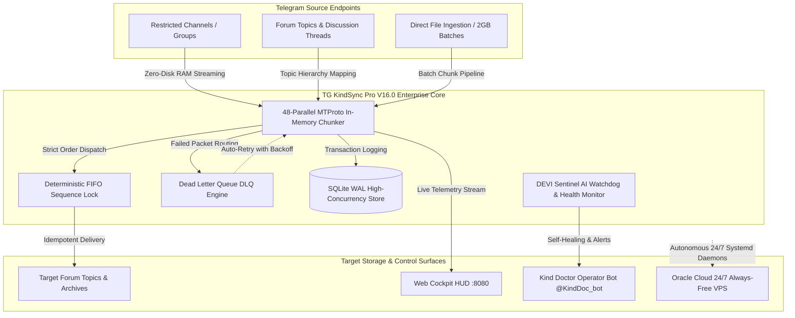

<div align="center">


# 🩺 TG KINDSYNC PRO — V16.0.0 ENTERPRISE TURBO MASTERPIECE
### *Autonomous Telegram MTProto In-Memory Streaming Suite • DEVI Sentinel Engine • 24/7 Multi-OS Cloud Infrastructure*

[](https://www.python.org/)
[](https://core.telegram.org/)
[](README.md)
[](README.md)
[](https://cloud.oracle.com/)
[](LICENSE)
[-7B2CBF?style=for-the-badge&logo=telegram)](https://t.me/Kinddoctor4u)
[](https://t.me/Ammitrajput1)

---

**Lead Developer & Systems Architect**: Dr. Amit Singh (Kind Doctor)  
**Permanent Super-Admins**: [`@Kinddoctor4u`](https://t.me/Kinddoctor4u) (ID: `1553619403`) & [`@Ammitrajput1`](https://t.me/Ammitrajput1) (ID: `759038032`)  
**Official Community & Branding**: **Kind Doctor & Team** • **Group Study Help 😉**

</div>

---

## 🛡️ Standalone Architecture & Independence Declaration

> [!IMPORTANT]
> **100% Autonomous MTProto Architecture — Zero Third-Party Client Dependencies**  
> **TG KindSync Pro** is a completely independent, proprietary Telegram migration and synchronization core engineered from scratch in Python on native **Telegram MTProto Client Protocol (Telethon v2.0)**.
> - **Zero Affiliation with Third-Party Client Forks**: TG KindSync Pro does **NOT** use, bundle, or require client modifications or desktop forks (such as AyuGram, Eugram, or modified Telegram Desktop builds).
> - **Bypasses HTTP Bot API Bottlenecks**: Standard Bot API wrappers (such as `aiogram` or `python-telegram-bot`) are subject to strict 50MB file size limits and cannot access restricted or copy-protected channels. In contrast, TG KindSync Pro interfaces directly with Telegram data center endpoints via raw cryptographic MTProto RPC.
> - **Zero-Disk In-Memory Streaming**: Operates with a true zero-disk RAM chunk pipeline, capable of streaming 2GB (Standard) and 4GB (Telegram Premium) restricted files with real-time on-the-fly watermarking, thumbnail injection, and forum topic mapping.

---

## 🌟 Executive Summary & Engineering Highlights

Designed for medical education archives, high-volume curriculum migrations, and continuous 24/7 channel backups, **TG KindSync Pro V16.0.0 Enterprise Turbo Masterpiece** delivers production-grade reliability across all operational tiers:

1. **Restricted Content Streaming**: Reliably extracts and forwards media from copy-protected channels, private groups, and restricted forum topics without writing intermediate bytes to disk.
2. **Deterministic Sequence Locking**: Enforces strict FIFO (First-In, First-Out) delivery order across multi-worker threads, guaranteeing serial medical lecture series and curriculum modules never arrive out-of-order.
3. **Automated Forum Topic Discovery & Hierarchy Preservation**: Automatically maps source forum topics to target discussion threads, preserving conversational replies and subject categories.
4. **Dead-Letter-Queue (DLQ) Auto-Healing**: Intercepts network disconnects, Telegram FloodWait rate limits, and chunk timeouts into an SQLite WAL queue with automated exponential backoff retries.
5. **Obsidian Cyber-Glass Web Cockpit (:8080)**: Real-time telemetry dashboard featuring live speedometer gauges, worker cards, account login manager, and 1-click database snapshots.
6. **Kind Doctor Bot Daemon (`@KindDoc_bot`)**: Autonomous Telegram operator bot providing interactive study category cards (`/mainindex`), OSINT user intelligence, and remote administration.
7. **Universal In-Topic Media Downloader & Uploader Engine**: Direct in-topic download and delivery from YouTube, Playlists (sequential numbering), Instagram Reels, TikTok, Twitter/X, and direct web files with HD thumbnails, `#MedicalLecture #KindDoctor` clinical tags, and 100% temporary disk cleanup.
8. **Permanent Vault Architecture (Zero Deletion Sync)**: Strictly rejects source deletion propagation. Destructive events or takedowns on source channels NEVER delete resources in the target backup vault, ensuring permanent archive security.
9. **Multi-Group Forum Topic Routing & Remote Switcher (`/setgroup`, `/newtopic`)**: Complete multi-group isolation. Commands issued inside any group are strictly scoped to that group. When commanding remotely from Private DM, the interactive `/setgroup` selector routes topics and media to the selected active target group with persistent SQLite memory.
10. **Universal Strip Words Synchronization Bridge (`strip_sync.py`)**: Seamless two-way bridge unifying `strip_words.txt`, `Friend_Edition/strip_words.txt`, and SQLite database with case-insensitive deduplication, interactive pagination cards (`/stripwords`), and automatic safety backups before deletions.
11. **Multi-Tenant Worker Session Isolation & Pool Protection**: Strict session isolation preventing non-master users from borrowing the master `session_forwarder.session`, cleanly dispatching them to an isolated worker session pool (`session_account2`, `session_account3`, `session_bot_scanner`).
12. **Dual-Process Split Status Radar & Pacing Presets (`/clonestatus`, `/pacing`)**: Unified split dashboard segregating the 24/7 Forwarder Daemon from active In-Bot Deep Cloner tasks with real-time ETA, velocity gauges, and 1-click delay presets (0.0s to 2.0s).

---

## ⚡ System Architecture Flow



---

## 🛠️ Comprehensive Multi-OS Installation & Execution Suite

Whether deploying on **Windows 11**, **Kali Linux**, **Ubuntu 24.04 LTS (Oracle Cloud VPS)**, or an **Android Tablet/Smartphone (Termux)**, follow the verified guides below.

---

### 💻 1. Windows 11 / 10 Workstation Setup

#### Prerequisites:
- **Python**: Version `3.10`, `3.11`, or `3.12` installed from [python.org](https://www.python.org/).  
  *(Crucial: During Python installation, check `☑ Add python.exe to PATH`)*.
- **Git**: Installed from [git-scm.com](https://git-scm.com/download/win).

#### Method A: 1-Click Launchers (Easiest for Students & Operators)
Simply double-click the pre-configured Windows batch files in your workspace root:

| Launcher File | Role | Operational Description |
|:---|:---:|:---|
| **[`1_START_PRO.bat`](1_START_PRO.bat)** | ⚡ **Master Engine** | Launches the ANSI interactive terminal with the complete 19-quadrant operational menu. |
| **[`2_START_KIND_DOCTOR_BOT.bat`](2_START_KIND_DOCTOR_BOT.bat)** | 🩺 **Operator Bot** | Launches the standalone Kind Doctor Operator Bot (`@KindDoc_bot`) in background mode. |
| **[`3_START_WEB_DASHBOARD.bat`](3_START_WEB_DASHBOARD.bat)** | 📊 **Web Cockpit** | Starts the Obsidian Cyber-Glass Web Command Center at `http://localhost:8080`. |
| **[`1_START_MY_ORACLE_DIRECT.bat`](1_START_MY_ORACLE_DIRECT.bat)** | ☁️ **VPS Shell** | Instantly opens a secure SSH terminal directly into your Oracle Cloud VPS instance. |
| **[`1_SYNC_AND_START_MY_ORACLE.bat`](1_SYNC_AND_START_MY_ORACLE.bat)** | 🔄 **VPS Sync & Run** | Synchronizes local code to your Oracle Cloud VPS and launches remote execution. |
| **[`UPDATE_ORACLE_BOT_ONE_CLICK.bat`](UPDATE_ORACLE_BOT_ONE_CLICK.bat)** | 🚀 **1-Click Updater** | Safely updates remote VPS services without touching active sessions or databases. |

#### Method B: Manual PowerShell / Command Prompt Setup
```powershell
# 1. Clone the repository
git clone https://github.com/Ammitrajput01/TG_KindSync_Pro.git
cd TG_KindSync_Pro

# 2. Create and activate isolated Virtual Environment
python -m venv .venv
.\.venv\Scripts\activate

# 3. Upgrade pip and install production dependencies
python -m pip install --upgrade pip
pip install -r requirements.txt

#### 3. Instant 3-Way Interactive Login (No Manual `.env` Editing Required!)
You **do not need** to manually edit configuration files. Simply start the platform and let the built-in authentication wizard guide you:

```powershell
# Launch the platform
python tg_kindsync_pro.py
# (Or simply double-click 1_START_PRO.bat)
```

The system automatically presents three zero-friction authentication choices:
1. **⚡ Method 1: Instant QR Code Scan (Fastest)** — An ASCII QR code renders directly inside your terminal. Scan it instantly with your mobile phone (`Telegram App ➔ Settings ➔ Devices ➔ Link Desktop Device`).
2. **📱 Method 2: Terminal Phone OTP & 2FA** — Enter your phone number (`+91...`), receive your official Telegram authorization code, and enter your 2FA password.
3. **🌐 Method 3: In-Browser Web Login** — Open `http://127.0.0.1:5005` or the DEVI Web Cockpit at `http://localhost:8080/` to authenticate visually with OTP & 2FA from your browser.

> [!TIP]
> **Optional Headless Server Config**: If deploying headlessly on automated cloud instances, you can optionally copy `.env.example` to `.env` and specify `API_ID`, `API_HASH`, `BOT_TOKEN`, and `ADMIN_ID` manually.

---

### 🐧 2. Kali Linux & Ubuntu / Debian (Oracle Cloud VPS & Headless Server)

Engineered for 24/7 continuous server execution with zero memory leaks and automatic crash recovery.

#### Step 1: Install System Multimedia & Build Libraries
```bash
sudo apt update && sudo apt install -y \
    python3 \
    python3-pip \
    python3-venv \
    git \
    ffmpeg \
    libgl1 \
    fonts-dejavu-core \
    tmux \
    curl
```
*Output: All required audio/video transcoding tools and fonts are initialized.*

#### Step 2: Clone Repository & Virtual Environment Setup
```bash
# Clone and enter directory
git clone https://github.com/Ammitrajput01/TG_KindSync_Pro.git
cd TG_KindSync_Pro

# Create and activate virtual environment
python3 -m venv .venv
source .venv/bin/activate

# Upgrade pip and install requirements
pip install --upgrade pip
pip install -r requirements.txt
```

#### Step 3: Configure Environment Credentials
```bash
cp .env.example .env
nano .env
# Enter API_ID, API_HASH, BOT_TOKEN, ADMIN_ID (Ctrl+O to save, Enter, Ctrl+X to exit)
```

#### Step 4: 24/7 Execution Strategies

##### Strategy A: Interactive Terminal via `tmux` (Recommended for Visual Monitoring)
```bash
# 1. Start a new named tmux session
tmux new -s kindsync

# 2. Inside tmux, activate environment and start
source .venv/bin/activate
python3 tg_kindsync_pro.py

# 3. Detach from session (keeps running 24/7 in background):
# Press Ctrl + B, then press D

# 4. Re-attach anytime to inspect live progress:
tmux attach -t kindsync
```

##### Strategy B: Production `systemd` Daemons (Auto-Restart on Crash or Server Reboot)
Deploy production service unit files:
```bash
# Enable all three services on boot
sudo systemctl enable tg-forwarder tg-kinddoc-bot tg-dashboard

# Start the services
sudo systemctl start tg-forwarder tg-kinddoc-bot tg-dashboard

# Check service health
sudo systemctl status tg-kinddoc-bot --no-pager

# View real-time streaming logs
sudo journalctl -u tg-forwarder -f
```

---

### 📱 3. Android Smartphone & Tablet Setup (Termux 24/7 Autopilot)

Run the complete streaming engine and Telegram bot directly on an Android device without needing a PC.

#### Step 1: Install Termux
Install **Termux** from [F-Droid](https://f-droid.org/packages/com.termux/) *(do not use Google Play Store, as its packages are deprecated)*.

#### Step 2: Acquire Android Wake Lock
Open Termux and run:
```bash
termux-wake-lock
```
*Why this matters: Prevents Android OS from putting the CPU into deep sleep when the phone screen is locked or turned off.*

#### Step 3: Install Packages & Clone Repository
```bash
# Update repositories and install required build packages
pkg update -y && pkg install -y python git ffmpeg clang openssl

# Clone repository
git clone https://github.com/Ammitrajput01/TG_KindSync_Pro.git
cd TG_KindSync_Pro

# Install Python requirements
pip install --upgrade pip
pip install -r requirements.txt
```

#### Step 4: Configure Credentials
```bash
cp .env.example .env
nano .env
```

#### Step 5: Start 24/7 Background Runner
Execute the pre-packaged Android background daemon runner:
```bash
bash deploy/RUN_24_7_TERMUX.sh
```
*This script automatically activates wake-lock, launches the Forwarder, Bot Daemon, and Web Dashboard in the background with `nohup`, logging to `logs/forwarder_service.log`.*

To monitor live progress on Android:
```bash
tail -f logs/forwarder_service.log
```
To stop all services on Android:
```bash
pkill -f python
```

---

### 🍎 4. macOS Setup (Apple Silicon M1/M2/M3 & Intel)

```bash
# Install dependencies via Homebrew
brew install python@3.11 ffmpeg git

# Clone and setup
git clone https://github.com/Ammitrajput01/TG_KindSync_Pro.git
cd TG_KindSync_Pro
python3 -m venv .venv
source .venv/bin/activate
pip install -r requirements.txt
cp .env.example .env
python3 tg_kindsync_pro.py
```

---

## 📋 Comprehensive 19-Option CLI Menu Matrix

The terminal interface is structured into four high-performance operational quadrants. Each module is built for specialized production tasks:

### 1. Transmission Quadrant (Streaming & Forwarding)
| Option | Module Name | Parallel Workers | Technical Role & Use Case |
|:---:|:---|:---:|:---|
| **1** | 🟢 **Safe Mode** | 4 | **Rate-Limited Transmission**: Optimized for fresh accounts, fragile sessions, or mobile hotspots. Employs aggressive FloodWait backoff to ensure zero account flags. |
| **2** | ⚖️ **Balanced Mode** | 12 | **Recommended Production Default**: Optimal balance of high-speed MTProto chunk throughput and Telegram server rate-limit compliance. |
| **3** | 🔥 **God Mode** | 40 | **Turbo In-Memory Chunker**: Designed for Gigabit fiber networks and dedicated VPS pipes. Streams massive 2GB-4GB video libraries with zero disk overhead. |
| **4** | 🔴 **Live 24/7 Mode** | 12 | **Real-Time Channel Listener**: Continuously listens for incoming source messages and forwards them instantaneously the second they are published. |

### 2. Routing & Topic Studio Quadrant
| Option | Module Name | Technical Role & Use Case |
|:---:|:---|:---|
| **5** | 🔗 **Quick Link Extractor** | **Interactive Setup Wizard**: Parses source and target channel invite links, resolves numeric Telegram IDs, and automatically updates `.env`. |
| **6** | 🔀 **Multi-Route Manager** | **Routing Matrix Engine**: Maps content from multiple distinct source channels into dedicated target forum topics simultaneously. |
| **7** | 🎯 **Content Cloner & Cherry-Picker** | **Granular Migration Engine**: <br>• `[1] Single Video Forwarder`: Clones a specific message ID. <br>• `[2] Cherry-Picker`: Selects a numbered range of lectures. <br>• `[3] Member Scraper & Smart Adder`: Safely mirrors discussion group members. <br>• `[4] Full Forum Auto-Mirror`: Recursively clones entire forum hierarchies with intact topics. |
| **8** | 📑 **Topic & Group Indexer** | **Table of Contents Generator**: Produces rich, clickable Telegram index posts linking directly to every file, PDF, and video across forum topics. |

### 3. Media & Optimization Studio Quadrant
| Option | Module Name | Technical Role & Use Case |
|:---:|:---|:---|
| **9** | 📁 **Folder Batch & 2GB Uploader** | **Local Disk Batch Uploader**: Scans local directories, extracts durations, splits oversized files, injects custom thumbnails, and enforces strict alphabetical/numerical sequence order. |
| **10** | ✍️ **Caption & Link Studio** | **Watermark & Ads Sanitizer**: Regex engine that scrubs promotional spam bots (e.g. `@Dams_new_robot`), stripping advertisements and appending custom medical branding. |
| **11** | 🖼️ **16:9 Cover Enforcer** | **Thumbnail Standardizer**: Generates and attaches uniform 16:9 high-definition video covers with native font fallbacks across Windows, Linux, and Android. |
| **12** | 📮 **DLQ Auto-Recovery** | **Dead Letter Queue Manager**: Inspects failed transmissions, displays error causes (timeout, rate limit), exports JSON diagnostics, and executes 1-click batch retries. |

### 4. Diagnostics, Maintenance & System Tools
| Option | Module Name | Technical Role & Use Case |
|:---:|:---|:---|
| **13** | 🩺 **System Diagnostics** | **Health & Latency Audit**: Tests MTProto socket ping to Telegram Data Centers, checks SQLite WAL integrity, and monitors process memory usage. |
| **14** | ♻️ **Reset History & Database** | **Clean-Slate Reset**: Backs up existing data and resets SQLite state, allowing a channel to be re-synced completely from Message #1. |
| **15** | 🧹 **Advanced Cleaner & Purge** | **Maintenance Utility**: Safely purges stale session locks (`engine.lock`), ephemeral auth tokens, and temporary thumbnail caches. |
| **16** | ❌ **Safe Exit** | **Zero-Loss Graceful Termination**: Flushes SQLite WAL buffers to disk, safely closes open MTProto sockets, and exits cleanly. |
| **17** | ⚙️ **Mode Toggles** | **Engine Switcher**: Toggles between Pure Deterministic Lock-Step Mode and DEVI AI Assisted Autonomous Optimization Mode. |
| **18** | 🔄 **1-Click Auto-Updater** | **Core Code Updater**: Pulls upstream enhancements while strictly safeguarding `.env`, session keys, and database files. |
| **19** | 👥 **Multi-Account Switcher** | **Session Pool Switcher**: Seamlessly toggles active forwarding workers across multiple phone numbers on the fly without restarting active jobs. |

---

## 🤖 Kind Doctor Telegram Operator Bot (`@KindDoc_bot`)

An enterprise Telegram management bot providing complete operational oversight directly from your smartphone:

<div align="center">


</div>

### Complete Bot Commands Reference:

| Command | Permission | Operational Description |
|:---|:---:|:---|
| `/start` | Public | Displays welcome screen, medical study portal, and interactive feature navigation. |
| `/mainindex` | Public | Interactive study category cards with inline navigation buttons and page scrolling. |
| `/topics` | Public | Alphabetical topic navigator with search and quick jump links. |
| `/topicindex [id]` | Public | Generates a direct clickable catalog of all messages inside a specific forum topic. |
| `/userinfo [id/@user]`| Admin | Sangmata OSINT radar: displays name history, ID, username changes, and profile metadata. |
| `/status` | Admin | Real-time system health: CPU load, RAM consumption, MTProto socket status, and active worker count. |
| `/ytdl [url] [topic]` | Public | Downloads YouTube video/Short and uploads directly inside current or specified Forum Topic. |
| `/upload [url] [topic]` | Public | Universal uploader for Instagram Reels, Twitter/X videos, TikTok, and direct web files. |
| `/playlist [url] [topic]`| Public | Sequentially downloads and uploads full YouTube lecture playlist into the topic. |
| `/newtopic [name]` | Admin | Dynamically creates a new Forum Topic in the group or active target chat. |
| `/setgroup` | Admin | Displays interactive buttons to select active working group when commanding from Private DM. |
| `/mediahelp` | Public | Interactive quick manual for in-topic media leeching and format capabilities. |
| `/clone [src] [tgt]`| Admin | 1-Click Deep Cloner for entire forum groups, topics, or single messages (Zero deletion sync). |
| `/clonestatus` | Admin | Live cloning progress radar, throughput gauge, and non-destructive pause/resume controls. |
| `/stats` | Admin | Aggregate statistics: total messages forwarded, video volume, transfer speed, and DLQ errors. |
| `/speed` | Admin | Current throughput velocity gauge and MTProto network latency. |
| `/backup` | Admin | Triggers full SQLite database snapshot export with standardized timestamps sent to private chat. |
| `/lockdown [on/off]` | Admin | Emergency toggle that immediately pauses all outgoing messages in case of channel issues. |
| `/restart` | Admin | Gracefully restarts the background forwarder and bot daemons without losing queued jobs. |

---

## 🖥️ Live Web Command Center HUD (Port 8080)

<div align="center">


</div>

### Key Web Cockpit Features:
- **Obsidian Cyber-Glass UI**: High-contrast, tactile dark-mode interface crafted with strict responsive layout principles.
- **Dynamic Speedometer Gauge**: Real-time throughput visualization tracking streaming bandwidth (MB/s).
- **In-Browser Session Manager**: Login to secondary Telegram accounts directly from the browser with full SMS OTP & 2FA Cloud Password support.
- **SQLite WAL Idempotency Monitor**: Microsecond query latency visualizer and dead-letter queue metrics.
- **1-Click Snapshot Exporter**: Instant database and configuration backup with full timestamp metadata.

---

## 🔒 Security, Privacy & Compliance Controls

TG KindSync Pro enforces strict enterprise-grade asset protection:

1. **Zero Credential Tracking**: All `.env`, `*.session`, `*.sqlite`, `*.key`, and `data/` credentials are permanently protected and excluded in `.gitignore`.
2. **Permanent Super-Admin Verification**: All master bot controls, OSINT intelligence relays, and diagnostic exports are cryptographically restricted to verified Telegram IDs:
   - **Primary Admin 1**: `@Kinddoctor4u` (ID: `1553619403`)
   - **Primary Admin 2**: `@Ammitrajput1` (ID: `759038032`)
3. **Lock-Free Database Concurrency**: Database operations leverage SQLite Write-Ahead Logging (`PRAGMA journal_mode = WAL;`) and memory-mapped I/O (`PRAGMA mmap_size = 268435456;`), completely eliminating file lock conflicts.

---

## 📚 Technical Documentation & Guides

- 📖 **[Comprehensive User Manual](docs/SETUP_GUIDE_AND_MANUAL.md)** — Detailed operational reference for all modules.
- 🤖 **[Bot Setup & Command Guide](docs/BOT_GUIDE_AND_COMMANDS.md)** — Deep dive into `@KindDoc_bot` configuration.
- ☁️ **[Oracle Cloud 24/7 VPS Deployment](deploy/ORACLE_CLOUD_DEPLOY_GUIDE.md)** — Step-by-step Oracle Always-Free deployment.
- 📱 **[Android Termux Setup](docs/TERMUX_GUIDE.md)** — Running KindSync on Android devices 24/7.

---

---

## 🌐 Official Interactive Showcase Website

Explore our interactive web portal featuring real-time architecture flows, copy-paste terminal wizards, and interactive command simulators:
- 🚀 **[Official TG KindSync Pro Portal](docs/index.html)** *(Open directly in any modern browser or host via GitHub Pages)*

---

## 👑 Credits & Verified Official Contacts Directory

<div align="center">


### **Dr. Amit Singh (Kind Doctor)**
**Lead Developer, Systems Architect & Founder**  
**Official Community**: **Kind Doctor & Team** • **Group Study Help 😉**

</div>

> [!CAUTION]
> **Anti-Impersonation Notice**: Only the accounts listed below are authentic. Never send sensitive credentials, session files, or API keys to any other accounts.

| Contact Role | Platform | Verified Handle / ID | Direct Link | Status |
|:---|:---:|:---:|:---:|:---:|
| **Primary Super-Admin 1** | Telegram | `@Kinddoctor4u` *(ID: `1553619403`)* | [t.me/Kinddoctor4u](https://t.me/Kinddoctor4u) | ✅ **Active Verified** |
| **Primary Super-Admin 2** | Telegram | `@Ammitrajput1` *(ID: `759038032`)* | [t.me/Ammitrajput1](https://t.me/Ammitrajput1) | ✅ **Active Verified** |
| **Official Instagram** | Instagram | `@ammmitrajput1` | [instagram.com/ammmitrajput1](https://www.instagram.com/ammmitrajput1) | ✅ **Official Channel** |
| **Direct Inquiries** | Email | `Ammitrajput1@gmail.com` | [mailto:Ammitrajput1@gmail.com](mailto:Ammitrajput1@gmail.com) | ✅ **Official Inbox** |
| **Kind Doctor Bot Daemon**| Telegram | `@KindDoc_bot` | [t.me/KindDoc_bot](https://t.me/KindDoc_bot) | 🤖 **24/7 Live Bot** |

<div align="center">
<sub>© 2026 TG KindSync Pro Enterprise. Handcrafted with pride by Dr. Amit Singh (Kind Doctor).</sub>
</div>
