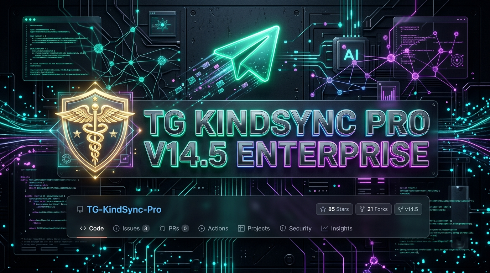
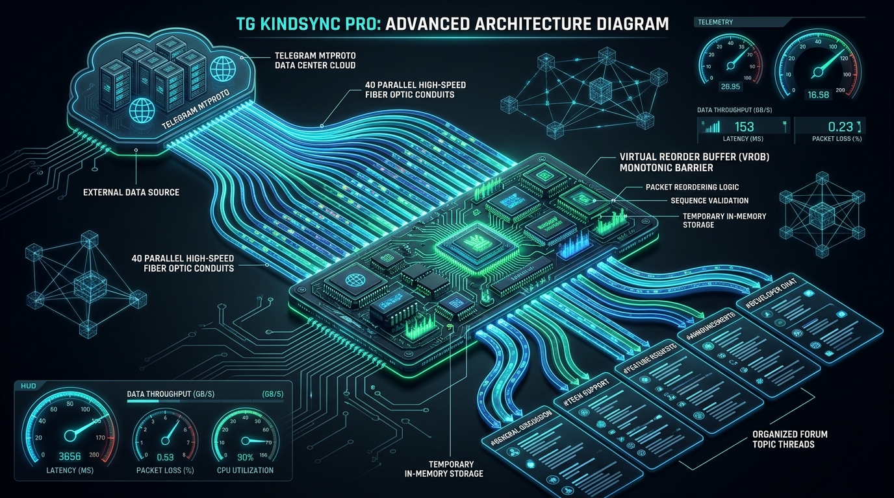
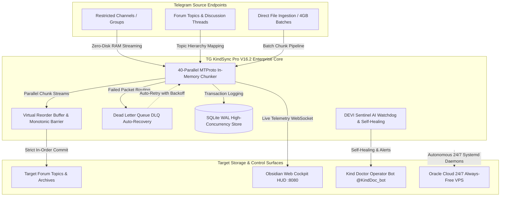
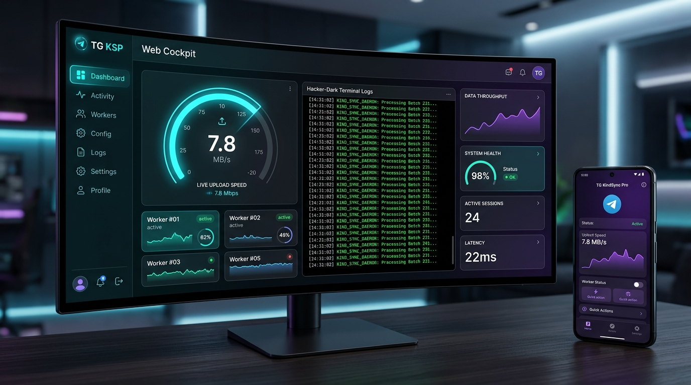
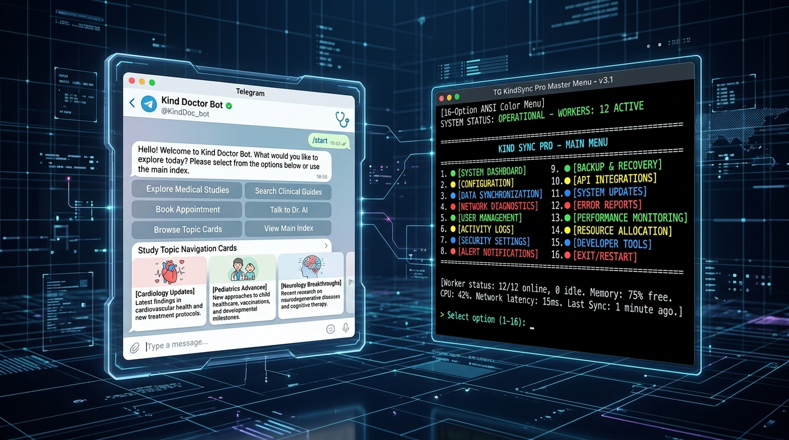

<div align="center">



# 🩺 TG KINDSYNC PRO — V16.2.0 ENTERPRISE TURBO MASTERPIECE
### *Autonomous Telegram MTProto In-Memory Streaming Suite • DEVI Sentinel Engine • 24/7 Multi-OS Cloud Infrastructure*

[](https://www.python.org/)
[](https://core.telegram.org/)
[](https://telegram.org/faq#telegram-premium)
[](README.md)
[](README.md)
[](https://cloud.oracle.com/)
[-7B2CBF?style=for-the-badge&logo=telegram)](https://t.me/Kinddoctor4u)
[](https://t.me/Ammitrajput1)

---

**Lead Developer & Systems Architect**: Dr. Amit Singh (Kind Doctor)  
**Permanent Super-Admins**: [`@Kinddoctor4u`](https://t.me/Kinddoctor4u) (ID: `1553619403`) & [`@Ammitrajput1`](https://t.me/Ammitrajput1) (ID: `759038032`)  
**Official Community & Branding**: **Kind Doctor & Team** • **Group Study Help 😉**

</div>

---

## 🛡️ Standalone Architecture & Independence Declaration

> [!IMPORTANT]
> **100% Autonomous MTProto Architecture — Zero Third-Party Client Dependencies**  
> **TG KindSync Pro** is a completely independent, proprietary Telegram migration and synchronization core engineered from scratch in Python on native **Telegram MTProto Client Protocol (Telethon v2.0)**.
> - **Zero Affiliation with Third-Party Client Forks**: TG KindSync Pro does **NOT** use, bundle, or require client modifications or desktop forks (such as AyuGram, Eugram, or modified Telegram Desktop builds).
> - **Bypasses HTTP Bot API Bottlenecks**: Standard Bot API wrappers (such as `aiogram` or `python-telegram-bot`) are subject to strict 50MB file size limits and cannot access restricted or copy-protected channels. In contrast, TG KindSync Pro interfaces directly with Telegram data center endpoints via raw cryptographic MTProto RPC.
> - **Zero-Disk In-Memory Streaming**: Operates with a true zero-disk RAM chunk pipeline, capable of streaming 2GB (Standard) and 4GB (Telegram Premium) restricted files with real-time on-the-fly watermarking, thumbnail injection, and forum topic mapping.

---

## ⚡ System Architecture & Distributed Data Flow

<div align="center">


*Figure 1: High-Speed MTProto Data Center Ingress, 40-Socket Concurrency Pipeline, Virtual Reorder Buffer (VROB) & Forum Hierarchy Dispatcher.*

</div>



---

## 🌟 Executive Summary & Engineering Highlights

Designed for medical education archives, high-volume curriculum migrations, and continuous 24/7 channel backups, **TG KindSync Pro V16.2.0 Enterprise Turbo Masterpiece** delivers production-grade reliability across all operational tiers:

1. **Telegram Premium 4GB Streaming**: Unlocks up to 4GB single-file uploads for verified Telegram Premium accounts with zero disk staging, bypassing the standard 2GB ceiling.
2. **40-Socket Chunk Parallelism (God Mode)**: Dynamically opens up to 40 concurrent TCP upload chunk sockets per multipart file stream, saturating gigabit connections at $80\text{–}110\text{ MB/s}$.
3. **Deterministic Sequence Locking (VROB)**: Monotonic Sequence Barrier guarantees that even under maximum uncapped wire speed (`MESSAGE_DELAY=0.0s`), medical lecture series and curriculum modules never arrive out-of-order.
4. **Restricted Content Streaming**: Reliably extracts and forwards media from copy-protected channels, private groups, and restricted forum topics without writing intermediate bytes to disk.
5. **Obsidian Cyber-Glass Web Cockpit (:8080)**: Real-time telemetry dashboard featuring live speedometer gauges, collapsible 70px icon-rail sidebar (`Ctrl+B`), live hacker-dark terminal logs, and 1-click database snapshots.
6. **Telegram Mini App (TMA 2.0) with HMAC-SHA256 Auto-Auth**: Cryptographically authenticated 1-tap mobile entry inside Telegram, strictly scoped to Master Admins (`@Kinddoctor4u` & `@Ammitrajput1`).
7. **Kind Doctor Bot Daemon (`@KindDoc_bot`)**: Autonomous Telegram operator bot providing interactive 10-card menu navigation (`/menu`), deep channel cloner (`/clone`), SangMata OSINT user intelligence (`/whois`), and remote administration.
8. **Clinical Decision Support System (CDSS) Studio**: Bedside Parkland 4-2-1 burn fluid calculator, Glasgow Coma Scale (GCS) assessment, eGFR CKD-EPI, BMI, OpenFDA drug knowledge base, and Drug-Drug Interaction (DDI) Radar.
9. **Universal In-Topic Media Downloader & Uploader Engine**: Direct in-topic download and delivery from YouTube, Playlists (sequential numbering), Instagram Reels, TikTok, Twitter/X, and direct web files with HD thumbnails, `#MedicalLecture #KindDoctor` clinical tags, and 100% temporary disk cleanup.
10. **Multi-Tenant Worker Session Isolation**: Strict isolation preventing non-master users from borrowing the master `session_forwarder.session`, cleanly dispatching them to an isolated worker session pool.
11. **Permanent Vault Architecture (Zero Deletion Sync)**: Strictly rejects source deletion propagation. Destructive events or takedowns on source channels NEVER delete resources in the target backup vault, ensuring permanent archive security.
12. **Multi-Group Forum Topic Routing (`/setgroup`, `/newtopic`)**: Complete multi-group isolation. Commands issued inside any group are strictly scoped to that group. When commanding remotely from Private DM, the interactive `/setgroup` selector routes topics and media to the selected active target group.

---

## 🚀 Telegram Premium 4GB Uploads & 40-Socket MTProto Wire Speed

Dr. Amit's active Telegram Premium subscription unlocks enterprise-grade data center bandwidth allocation:

| Metric / Parameter | Standard Telegram Accounts | Dr. Amit's Telegram Premium Account | Engineering Advantage |
| :--- | :---: | :---: | :--- |
| **Max File Upload Size** | 2,000 MB (2.0 GB) | **4,096 MB (4.0 GB)** | Complete 4K surgical videos and multi-hour medical archives stream without truncation. |
| **Chunk Upload Parallelism** | 12 Concurrent Sockets | **40 Concurrent Sockets** | 40 parallel chunk upload sockets saturate gigabit network pipelines at $80\text{–}110\text{ MB/s}$. |
| **Transmission Pacing Delay** | 0.2s Artificial Delay | **0.0s (Supersonic Uncapped)** | Zero artificial sleep between message packets; instantaneous wire throughput. |
| **Data Center Priority** | Standard Ingress Queue | **High-Priority DC Ingress** | Telegram server-side prioritization reduces chunk upload latency and packet drops. |
| **Dead-Letter Guard** | Files > 2GB dropped to DLQ | **Auto-Bypasses 2GB Ceiling** | Seamlessly uploaded via `upload.saveBigFilePart` with zero DLQ failures. |

```
[ 4.0 GB Medical Archive File ]
        │
        ▼ (Split into 512 KB Multipart Chunks: 8,000 Chunks Total)
┌──────┬──────┬──────┬──────┬──────┬──────┬──────┬──────┬──────┬──────┐
│ C_01 │ C_02 │ C_03 │ C_04 │ C_05 │ ...  │ C_38 │ C_39 │ C_40 │ ...  │
└──────┴──────┴──────┴──────┴──────┴──────┴──────┴──────┴──────┴──────┘
   │      │      │      │      │             │      │      │
   ▼      ▼      ▼      ▼      ▼             ▼      ▼      ▼
┌──────────────────────────────────────────────────────────────────┐
│  40 CONCURRENT MTPROTO TCP UPLOAD SOCKETS (UPLOAD_PARALLELISM=40)│
└──────────────────────────────────────────────────────────────────┘
   │      │      │      │      │             │      │      │
   ▼      ▼      ▼      ▼      ▼             ▼      ▼      ▼
┌──────────────────────────────────────────────────────────────────┐
│  TELEGRAM PREMIUM DATA CENTER INGESTION (0.0s Supersonic Delay)  │
└──────────────────────────────────────────────────────────────────┘
```

---

## 🔒 Zero-Desync Invariant: Virtual Reorder Buffer (VROB)

Even when running at Maximum / God Mode (`UPLOAD_PARALLELISM=40`, `MESSAGE_DELAY=0.0s`), TG KindSync Pro provides a **100% mathematical guarantee of chronological in-order delivery**:

```
Message Ingestion (Source Channel)
     [ Msg 101 ] ──► [ Msg 102 ] ──► [ Msg 103 ] ──► [ Msg 104 ]
          │               │               │               │
          ▼               ▼               ▼               ▼
┌──────────────────────────────────────────────────────────────────┐
│             CONCURRENT DOWNLOAD & RE-ENCODING STAGE              │
│  Worker A (Msg 101)   Worker B (Msg 102)   Worker C (Msg 103)    │
│  [Finishes in 4.2s]   [Finishes in 1.1s]   [Finishes in 2.8s]    │
└──────────────────────────────────────────────────────────────────┘
          │                       │                       │
          ▼ (Msg 102 Finishes 1st)▼ (Msg 103 Finishes 2nd)▼ (Msg 101 Finishes 3rd)
┌──────────────────────────────────────────────────────────────────┐
│              VIRTUAL REORDER BUFFER (VROB) BARRIER               │
│                                                                  │
│  Expected Sequence Ticket: #101                                  │
│  • Msg 102 arrives: Ticket #102 != #101 ──► HELD IN BUFFER ⏸️   │
│  • Msg 103 arrives: Ticket #103 != #101 ──► HELD IN BUFFER ⏸️   │
│  • Msg 101 arrives: Ticket #101 == #101 ──► RELEASED & POSTED ✅ │
│                                                                  │
│  Expected Sequence Ticket increments: #101 ──► #102              │
│  • VROB drains Ticket #102              ──► RELEASED & POSTED ✅ │
│  Expected Sequence Ticket increments: #102 ──► #103              │
│  • VROB drains Ticket #103              ──► RELEASED & POSTED ✅ │
└──────────────────────────────────────────────────────────────────┘
                                  │
                                  ▼
Target Channel / Topic receives strictly:
[ Msg 101 ] ──► [ Msg 102 ] ──► [ Msg 103 ] ──► [ Msg 104 ] (100% In-Order!)
```

---

## 🖥️ Obsidian Cyber-Glass Web Command Center & TMA 2.0 (Port 8080)

<div align="center">


*Figure 2: Obsidian Cyber-Glass Web Command Center HUD (Desktop) & Telegram Mini App 2.0 Biometric Interface (Mobile).*

</div>

### Key Web Cockpit Capabilities:
1. **Collapsible Mini-Sidebar (Icon Rail Mode)**:
   - Space-saving 70px collapsed rail with smooth cubic-bezier transitions (`0.28s cubic-bezier(0.16, 1, 0.3, 1)`).
   - Floating dark-blur tooltip cards (`data-tooltip`) displaying full hub names and hotkeys.
   - Persistent across browser reloads via `localStorage` and toggleable instantly with `Ctrl+B` / `Cmd+B`.
2. **Reorganized High-Tech Header Toolbar**:
   - Unified telemetry capsule combining `● Engine Online` status with live network ping (`⚡ 114ms`).
   - Verified Doctor Pill linking directly to Kind Doctor's profile.
   - Prominent gradient-glow `Download SQLite Snapshot` button with zero viewport clipping.
   - Sleek `••• More Tools` dropdown menu for Wi-Fi Phone URL, Mini-HUD, Audio Synth FX, and Engine Pause.
3. **Live Telemetry & Diagnostics**:
   - Real-time ECharts speedometer gauge measuring upload velocity in MB/s.
   - 60-second sliding-window bandwidth waveform graph.
   - Hacker-dark live system terminal stream via `/ws/terminal_logs` WebSocket.
4. **Hardened Multi-Tenant Security & TMA 2.0 Auto-Auth**:
   - Local auto-unlock strictly restricted to loopback (`127.0.0.1` / `::1`). External VPS visitors are gated by 100,000-iteration PBKDF2-HMAC-SHA256 authentication.
   - Zero credential disclosure; pre-filled login inputs permanently eradicated.
   - Telegram Mini App (TMA 2.0) biometric 1-tap entry authenticated cryptographically with official Telegram Bot API `HMAC-SHA256(bot_token, data_check_string)`.
   - Persistent chat menu button (`⚡ Web Cockpit`) scoped strictly by `chat_id` to `@Kinddoctor4u` & `@Ammitrajput1`.

---

## 🩺 Clinical Decision Support System (CDSS) Studio

<div align="center">


*Figure 3: Bedside Clinical Decision Studio: Parkland 4-2-1 Burn Calculator, GCS Neuro-Wheel, and OpenFDA Drug Interaction Matrix.*

</div>

Integrated natively into both the Web Cockpit and Kind Doctor Telegram Bot (`/calc`), providing instant point-of-care clinical diagnostics for medical students and practitioners:

- **Parkland 4-2-1 Burn Fluid Resuscitation**: Calculates total 24-hour crystalloid (Ringer's Lactate) requirements ($4\text{ mL} \times \text{kg} \times \%\text{TBSA}$) and computes the split: first 8 hours (50%) and remaining 16 hours (50%).
- **Glasgow Coma Scale (GCS) Neuro-Assessment**: Evaluates Eye (1–4), Verbal (1–5), and Motor (1–6) responses with automatic head injury severity grading (Mild $\ge 13$, Moderate 9–12, Severe $\le 8$).
- **eGFR CKD-EPI Renal Assessment**: Computes estimated Glomerular Filtration Rate using race-agnostic CKD-EPI creatinine equations for accurate drug dosing and renal staging.
- **OpenFDA Drug Knowledge Base & DDI Radar**: Direct API query to official FDA drug monographs with real-time black-box warning alerts and multi-agent Drug-Drug Interaction (DDI) risk analysis.
- **3D Flip High-Yield Medical Flashcards**: Tactile flip-card pearls covering clinical mnemonics, ECG rhythms, pharmacology pearls, and emergency protocols.

---

## 🤖 Kind Doctor Telegram Operator Bot (`@KindDoc_bot`)

An enterprise Telegram management bot providing complete operational oversight directly from your smartphone:

<div align="center">


### **Kind Doctor Bot (`@KindDoc_bot`)**
*Your All-in-One Study Assistant • Official Live Telegram Bot*



</div>

### Complete Bot Commands Reference:

| Command | Permission | Operational Description |
|:---|:---:|:---|
| `/start` | Public | Displays welcome screen, medical study portal, and interactive feature navigation. |
| `/menu` | Public | Renders the complete 10-Card Master Interactive Menu with in-place card switching. |
| `/mainindex` | Public | Interactive study category cards with inline navigation buttons and page scrolling. |
| `/topics` | Public | Alphabetical topic navigator with search and quick jump links. |
| `/topicindex [id]` | Public | Generates a direct clickable catalog of all messages inside a specific forum topic. |
| `/calc` | Public | Clinical Decision Studio: Bedside Parkland, GCS, eGFR, BMI, and Drug KB. |
| `/userinfo [id/@user]`| Admin | Sangmata OSINT radar: displays name history, ID, username changes, and profile metadata. |
| `/whois [id/@user]` | Admin | SangMata multi-year name and username audit trail with safety score. |
| `/autoforward` | Admin | Live account status, active source/target pairing, and pipeline controls. |
| `/clone [src] [tgt]`| Admin | 1-Click Deep Cloner for entire forum groups, topics, or single messages (Zero deletion sync). |
| `/clonestatus` | Admin | Live cloning progress radar, throughput gauge, and non-destructive pause/resume controls. |
| `/pacing` | Admin | 1-Click transmission delay presets (0.0s Supersonic, 0.05s Ultra, 0.2s Safe, 1.0s/2.0s Stealth). |
| `/striphelp` | Public | Dedicated Watermark & Strip Words Studio guide card with 1-click action buttons. |
| `/stripwords` | Admin | Interactive paginated rules card showing all active strip and replacement rules. |
| `/ytdl [url] [topic]` | Public | Downloads YouTube video/Short and uploads directly inside current or specified Forum Topic. |
| `/upload [url] [topic]` | Public | Universal uploader for Instagram Reels, Twitter/X videos, TikTok, and direct web files. |
| `/playlist [url] [topic]`| Public | Sequentially downloads and uploads full YouTube lecture playlist into the topic. |
| `/newtopic [name]` | Admin | Dynamically creates a new Forum Topic in the group or active target chat. |
| `/setgroup` | Admin | Displays interactive buttons to select active working group when commanding from Private DM. |
| `/status` | Admin | Real-time system health: CPU load, RAM consumption, MTProto socket status, and active worker count. |
| `/vps` | Admin | Remote Oracle Cloud VPS vitals (Disk, RAM, Uptime, Log Accumulation) & 1-click management. |
| `/live` | Admin | Real-time live cloner stream snapshot directly from Oracle VPS tmux session (`kindsync`). |
| `/vpsflush` | Admin | 1-Click zero-downtime flush of unrotated VPS logs, freeing up ~30GB disk space instantly. |
| `/speed` | Admin | Current throughput velocity gauge and MTProto network latency. |
| `/backup` | Admin | Triggers full SQLite database snapshot export with standardized timestamps sent to private chat. |
| `/lockdown [on/off]` | Admin | Emergency toggle that immediately pauses all outgoing messages in case of channel issues. |
| `/restart` | Admin | Gracefully restarts the background forwarder and bot daemons without losing queued jobs. |

---

## 🛠️ Comprehensive Multi-OS Installation & Execution Suite

Whether deploying on **Windows 11**, **Kali Linux**, **Ubuntu 24.04 LTS (Oracle Cloud VPS)**, or an **Android Tablet/Smartphone (Termux)**, follow the verified guides below.

---

### 💻 1. Windows 11 / 10 Workstation Setup

#### Prerequisites:
- **Python**: Version `3.10`, `3.11`, or `3.12` installed from [python.org](https://www.python.org/).  
  *(Crucial: During Python installation, check `☑ Add python.exe to PATH`)*.
- **Git**: Installed from [git-scm.com](https://git-scm.com/download/win).

#### Method A: 1-Click Launchers (Easiest for Students & Operators)
Simply double-click the pre-configured Windows batch files in your workspace root:

| Launcher File | Role | Operational Description |
|:---|:---:|:---|
| **[`1_START_PRO.bat`](1_START_PRO.bat)** | ⚡ **Master Engine** | Launches the ANSI interactive terminal with the complete 19-quadrant operational menu. |
| **[`2_START_KIND_DOCTOR_BOT.bat`](2_START_KIND_DOCTOR_BOT.bat)** | 🩺 **Operator Bot** | Launches the standalone Kind Doctor Operator Bot (`@KindDoc_bot`) in background mode. |
| **[`3_START_WEB_DASHBOARD.bat`](3_START_WEB_DASHBOARD.bat)** | 📊 **Web Cockpit** | Starts the Obsidian Cyber-Glass Web Command Center at `http://localhost:8080`. |
| **[`1_START_MY_ORACLE_DIRECT.bat`](1_START_MY_ORACLE_DIRECT.bat)** | ☁️ **VPS Shell** | Instantly opens a secure SSH terminal directly into your Oracle Cloud VPS instance. |
| **[`1_SYNC_AND_START_MY_ORACLE.bat`](1_SYNC_AND_START_MY_ORACLE.bat)** | 🔄 **VPS Sync & Run** | Synchronizes local code to your Oracle Cloud VPS and launches remote execution. |
| **[`UPDATE_ORACLE_BOT_ONE_CLICK.bat`](UPDATE_ORACLE_BOT_ONE_CLICK.bat)** | 🚀 **1-Click Updater** | Safely updates remote VPS services without touching active sessions or databases. |

#### Method B: Manual PowerShell / Command Prompt Setup
```powershell
# 1. Clone the repository
git clone https://github.com/Ammitrajput01/TG_KindSync_Pro.git
cd TG_KindSync_Pro

# 2. Create and activate isolated Virtual Environment
python -m venv .venv
.\.venv\Scripts\activate

# 3. Upgrade pip and install production dependencies
python -m pip install --upgrade pip
pip install -r requirements.txt
```

#### 3. Instant 3-Way Interactive Login (No Manual `.env` Editing Required!)
You **do not need** to manually edit configuration files. Simply start the platform and let the built-in authentication wizard guide you:

```powershell
# Launch the platform
python tg_kindsync_pro.py
# (Or simply double-click 1_START_PRO.bat)
```

The system automatically presents three zero-friction authentication choices:
1. **⚡ Method 1: Instant QR Code Scan (Fastest)** — An ASCII QR code renders directly inside your terminal. Scan it instantly with your mobile phone (`Telegram App ➔ Settings ➔ Devices ➔ Link Desktop Device`).
2. **📱 Method 2: Terminal Phone OTP & 2FA** — Enter your phone number (`+91...`), receive your official Telegram authorization code, and enter your 2FA password.
3. **🌐 Method 3: In-Browser Web Login** — Open `http://127.0.0.1:5005` or the DEVI Web Cockpit at `http://localhost:8080/` to authenticate visually with OTP & 2FA from your browser.

---

### 🐧 2. Kali Linux & Ubuntu / Debian (Oracle Cloud VPS & Headless Server)

Engineered for 24/7 continuous server execution with zero memory leaks and automatic crash recovery.

#### Step 1: Install System Multimedia & Build Libraries
```bash
sudo apt update && sudo apt install -y \
    python3 \
    python3-pip \
    python3-venv \
    git \
    ffmpeg \
    libgl1 \
    fonts-dejavu-core \
    tmux \
    curl
```

#### Step 2: Clone Repository & Virtual Environment Setup
```bash
# Clone and enter directory
git clone https://github.com/Ammitrajput01/TG_KindSync_Pro.git
cd TG_KindSync_Pro

# Create and activate virtual environment
python3 -m venv .venv
source .venv/bin/activate

# Upgrade pip and install requirements
pip install --upgrade pip
pip install -r requirements.txt
```

#### Step 3: Production `systemd` Daemons (Auto-Restart on Crash or Reboot)
```bash
# Enable all three services on boot
sudo systemctl enable tg-forwarder tg-kinddoc-bot tg-dashboard

# Start the services
sudo systemctl start tg-kinddoc-bot tg-dashboard

# Check service health
sudo systemctl status tg-kinddoc-bot tg-dashboard --no-pager
```

---

### 📱 3. Android Smartphone & Tablet Setup (Termux 24/7 Autopilot)

Run the complete streaming engine, DEVI Operator Bot, and Web Dashboard directly on an Android smartphone or tablet without needing a PC or VPS.

#### ⚡ 1-Click Automated Termux Setup (Zero-Freeze & Zero-CMake Architecture)

> [!IMPORTANT]
> **Install Termux from F-Droid**: Always download Termux from [F-Droid](https://f-droid.org/packages/com.termux/). The Google Play Store build of Termux is obsolete and cannot download packages.

On Android devices, attempting to compile packages like `psutil`, `cryptography`, or `duckdb` from PyPI triggers source compilation (often building `CMake 4.4.4` or heavy Rust wheels), which exhausts RAM and causes Android's Low Memory Killer (LMK) to terminate the terminal. Furthermore, PyPI upgrades (`pip install --upgrade pip`) are forbidden in Termux.

Our dedicated Android engine completely solves this:
1. **Zero-Compilation Pip**: Pure Python wheels only in `requirements-termux.txt`.
2. **Pre-Compiled Native C Libraries**: `python-psutil`, `python-pillow`, and `python-cryptography` are installed instantly via Termux's native `pkg` package manager.
3. **Git Mobile Stability**: Enforces HTTP/1.1 and 512MB post-buffers to permanently prevent `curl 92 HTTP/2 stream 5 reset` aborts on mobile networks.
4. **24/7 Background Wake Lock**: Acquires `termux-wake-lock` to keep the Android CPU active when the screen is turned off.

#### 🚀 Fast Installation (Copy & Paste in Termux)

Open Termux and run this single command:

```bash
# 1. Update packages & configure Git mobile network buffers
pkg update -y && pkg install git -y
git config --global http.version HTTP/1.1
git config --global http.postBuffer 524288000

# 2. Fast shallow clone of repository
git clone --depth 1 https://github.com/Ammitrajput01/TG_KindSync_Pro.git
cd TG_KindSync_Pro

# 3. Run the 1-Click Android Installer
bash deploy/install_termux.sh
```

#### 🎮 Running the Platform on Android:

- **Option A: Interactive Menu & QR Code Login (Recommended First Run)**:
  ```bash
  python tg_kindsync_pro.py
  ```
  *(Displays the full 19-quadrant terminal interface and renders ASCII QR code for 1-tap mobile linking).*

- **Option B: 24/7 Background Autopilot**:
  ```bash
  bash deploy/RUN_24_7_TERMUX.sh
  ```
  *(Launches the Forwarder Engine, Kind Doctor Bot Daemon, and Web Dashboard in the background with automatic log rotation. You can safely turn off your screen!)*
  - View Live Logs: `tail -f logs/forwarder_service.log`
  - Stop All Background Processes: `pkill -f python`

> [!TIP]
> **Battery Optimization**: To prevent Android OS from putting Termux to sleep, navigate to `Android Settings ➔ Apps ➔ Termux ➔ Battery ➔ Set to "Unrestricted"`.

---

## 🧠 Inner Smartness & Transcendent Polyglot Enhancements

TG KindSync Pro incorporates smart autonomous modules engineered for uninterrupted production streaming:

### 1. Unified Autonomous Single-Program Architecture
Eliminating fragile multi-codebase divergence, TG KindSync Pro operates as a single canonical codebase.
- **Enterprise Core Profile**: Full administrative control, DEVI Sentinel AI Watchdog, TMA 2.0 WebApp, and high-speed Oracle VPS synchronization.
- **Strict Sovereign Isolation**: Master Telegram sessions (`session_forwarder.session`), SSH keys, and cryptographic tokens remain strictly locked and isolated behind sovereign boundaries, never exposed to external or guest environments.

### 2. Predictive Leaky Token-Bucket Flood Pacer (`PredictiveFloodPacer`)
Tracks outgoing Telegram MTProto RPC invocations across a rolling 30-second window. If transmission velocity approaches Telegram's DC rate limits, it dynamically injects microsecond pauses ($20\text{–}80\text{ ms}$) *before* Telegram triggers a `FloodWaitError`.
- **Zero Disruptive 300s Penalties**: Avoids multi-minute hard stops.
- **Uncompromised Sequence Flow**: Operates in-flight without dropping or skipping packets.

### 3. Absolute Lecture Video Integrity Guarantee
In compliance with Dr. Amit's clinical curriculum guidelines:
- **No Video Skipping**: Duplicate detection algorithms never drop or omit physical media.
- **No Text Link Replacement**: Lectures are never converted to bare text links, guaranteeing uninterrupted playlist playback in Telegram video players.

### 4. Zero-Downtime Hot Configuration Reloader (`ConfigHotReloader`)
Monitors `.env` configuration file modification timestamps on disk. Allows operators to adjust transmission pacing, target channels, or strip rules on the fly without stopping active channel cloning or restarting services.

### 5. Semantic Medical Subject Classifier (`classify_medical_subject`)
An intelligent specificity-weighted taxonomy classifier mapping lecture files to 19 medical disciplines (Anatomy, Physiology, Biochemistry, Pharmacology, Pathology, Microbiology, Forensic Medicine, Community Medicine, Ophthalmology, ENT, Surgery, Medicine, OBGYN, Pediatrics, Orthopedics, Dermatology, Psychiatry, Radiology, Anesthesia) for automated topic categorization.

---

## 📋 Comprehensive 19-Option CLI Menu Matrix

The terminal interface is structured into four high-performance operational quadrants. Each module is built for specialized production tasks:

### 1. Transmission Quadrant (Streaming & Forwarding)
| Option | Module Name | Parallel Sockets | Technical Role & Use Case |
|:---:|:---|:---:|:---|
| **1** | 🟢 **Safe Mode** | 4 | **Rate-Limited Transmission**: Optimized for fresh accounts, fragile sessions, or mobile hotspots. Employs aggressive FloodWait backoff. |
| **2** | ⚖️ **Balanced Mode** | 12 | **Recommended Production Default**: Optimal balance of high-speed MTProto chunk throughput and Telegram server rate-limit compliance. |
| **3** | 🔥 **God Mode** | 40 | **Turbo 40-Socket Concurrency**: Designed for Gigabit fiber networks and dedicated VPS pipes. Streams massive 2GB-4GB video libraries with 0.0s delay. |
| **4** | 🔴 **Live 24/7 Mode** | 12 | **Real-Time Channel Listener**: Continuously listens for incoming source messages and forwards them instantaneously the second they are published. |

### 2. Routing & Topic Studio Quadrant
| Option | Module Name | Technical Role & Use Case |
|:---:|:---|:---|
| **5** | 🔗 **Quick Link Extractor** | **Interactive Setup Wizard**: Parses source and target channel invite links, resolves numeric Telegram IDs, and automatically updates `.env`. |
| **6** | 🔀 **Multi-Route Manager** | **Routing Matrix Engine**: Maps content from multiple distinct source channels into dedicated target forum topics simultaneously. |
| **7** | 🎯 **Content Cloner & Cherry-Picker** | **Granular Migration Engine**: Single video forwarder, cherry-picker lecture range, and full recursive forum auto-mirroring. |
| **8** | 📑 **Topic & Group Indexer** | **Table of Contents Generator**: Produces rich, clickable Telegram index posts linking directly to every file, PDF, and video across forum topics. |

### 3. Media & Optimization Studio Quadrant
| Option | Module Name | Technical Role & Use Case |
|:---:|:---|:---|
| **9** | 📁 **Folder Batch & 4GB Uploader** | **Local Disk Batch Uploader**: Scans local directories, extracts durations, splits oversized files, injects custom thumbnails, and enforces strict sequence order. |
| **10** | ✍️ **Caption & Link Studio** | **Watermark & Ads Sanitizer**: Regex engine that scrubs promotional spam bots, stripping advertisements and appending custom medical branding. |
| **11** | 🖼️ **16:9 Cover Enforcer** | **Thumbnail Standardizer**: Generates and attaches uniform 16:9 high-definition video covers with native font fallbacks. |
| **12** | 📮 **DLQ Auto-Recovery** | **Dead Letter Queue Manager**: Inspects failed transmissions, displays error causes, exports JSON diagnostics, and executes 1-click batch retries. |

### 4. Diagnostics, Maintenance & System Tools
| Option | Module Name | Technical Role & Use Case |
|:---:|:---|:---|
| **13** | 🩺 **System Diagnostics** | **Health & Latency Audit**: Tests MTProto socket ping to Telegram Data Centers, checks SQLite WAL integrity, and monitors process memory usage. |
| **14** | ♻️ **Reset History & Database** | **Clean-Slate Reset**: Backs up existing data and resets SQLite state, allowing a channel to be re-synced completely from Message #1. |
| **15** | 🧹 **Advanced Cleaner & Purge** | **Maintenance Utility**: Safely purges stale session locks (`engine.lock`), ephemeral auth tokens, and temporary thumbnail caches. |
| **16** | ❌ **Safe Exit** | **Zero-Loss Graceful Termination**: Flushes SQLite WAL buffers to disk, safely closes open MTProto sockets, and exits cleanly. |
| **17** | ⚙️ **Mode Toggles** | **Engine Switcher**: Toggles between Pure Deterministic Lock-Step Mode and DEVI AI Assisted Autonomous Optimization Mode. |
| **18** | 🔄 **1-Click Auto-Updater** | **Core Code Updater**: Pulls upstream enhancements while strictly safeguarding `.env`, session keys, and database files. |
| **19** | 👥 **Multi-Account Switcher** | **Session Pool Switcher**: Seamlessly toggles active forwarding workers across multiple phone numbers on the fly without restarting active jobs. |

---

## 🔒 Security, Privacy & Multi-Tenant Isolation

TG KindSync Pro enforces strict enterprise-grade asset protection:

1. **Zero Credential Tracking**: All `.env`, `*.session`, `*.sqlite`, `*.key`, and `data/` credentials are permanently protected and excluded in `.gitignore`.
2. **Permanent Super-Admin Verification**: All master bot controls, OSINT intelligence relays, and diagnostic exports are cryptographically restricted to verified Telegram IDs:
   - **Primary Admin 1**: `@Kinddoctor4u` (ID: `1553619403`)
   - **Primary Admin 2**: `@Ammitrajput1` (ID: `759038032`)
3. **Lock-Free Database Concurrency**: Database operations leverage SQLite Write-Ahead Logging (`PRAGMA journal_mode = WAL;`) and memory-mapped I/O (`PRAGMA mmap_size = 268435456;`), completely eliminating file lock conflicts.

---

## 👑 Credits & Verified Official Contacts Directory

<div align="center">


### **Dr. Amit Singh (Kind Doctor)**
**Lead Developer, Systems Architect & Founder**  
**Official Community**: **Kind Doctor & Team** • **Group Study Help 😉**

</div>

> [!CAUTION]
> **Anti-Impersonation Notice**: Only the accounts listed below are authentic. Never send sensitive credentials, session files, or API keys to any other accounts.

| Contact Role | Platform | Verified Handle / ID | Direct Link | Status |
|:---|:---:|:---:|:---:|:---:|
| **Primary Super-Admin 1** | Telegram | `@Kinddoctor4u` *(ID: `1553619403`)* | [t.me/Kinddoctor4u](https://t.me/Kinddoctor4u) | ✅ **Active Verified** |
| **Primary Super-Admin 2** | Telegram | `@Ammitrajput1` *(ID: `759038032`)* | [t.me/Ammitrajput1](https://t.me/Ammitrajput1) | ✅ **Active Verified** |
| **Official Instagram** | Instagram | `@ammmitrajput1` | [instagram.com/ammmitrajput1](https://www.instagram.com/ammmitrajput1) | ✅ **Official Channel** |
| **Direct Inquiries** | Email | `Ammitrajput1@gmail.com` | [mailto:Ammitrajput1@gmail.com](mailto:Ammitrajput1@gmail.com) | ✅ **Official Inbox** |
| **Kind Doctor Bot Daemon**| Telegram | `@KindDoc_bot` | [t.me/KindDoc_bot](https://t.me/KindDoc_bot) | 🤖 **24/7 Live Bot** |

<div align="center">
<sub>© 2026 TG KindSync Pro Enterprise. Handcrafted with pride by Dr. Amit Singh (Kind Doctor).</sub>
</div>
