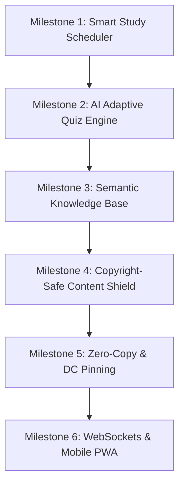

# 🩺 KIND DOCTOR & TEAM — MASTER PROJECT LOG & FUTURE ROADMAP
**Document Version:** `2.0.0-PRO` | **Last Updated:** `September 2026`  
**Author & Lead Architect:** Dr. Amit Singh (*Kind Doctor*)  
**System Ecosystem:** Telegram Kind Mode V14.0 PRO • DEVI Autonomous AI • @KindDoc_bot Hub • Universal Free AI Hub

---

## 📑 TABLE OF CONTENTS
1. [Executive Overview & Vision](#1-executive-overview--vision)
2. [Abhi Tak Ka Kaam (Complete Work Done So Far)](#2-abhi-tak-ka-kaam-complete-work-done-so-far)
   - [A. Telegram Kind Mode V14 Engine (Core Forwarder)](#a-telegram-kind-mode-v14-engine-core-forwarder)
   - [B. DEVI AI Ecosystem (5-Phase Autonomous Agent)](#b-devi-ai-ecosystem-5-phase-autonomous-agent)
   - [C. @KindDoc_bot (Medical Sentinel & Community Hub)](#c-kinddoc_bot-medical-sentinel--community-hub)
   - [D. Universal Free AI Model Hub & AI Council](#d-universal-free-ai-model-hub--ai-council)
   - [E. Web Dashboard, Ayugram Glass HUD & Companion](#e-web-dashboard-ayugram-glass-hud--companion)
   - [F. Verification Suites & 100% Test Coverage](#f-verification-suites--100-test-coverage)
   - [G. Deployment, Cloud & Android Termux Suite](#g-deployment-cloud--android-termux-suite)
3. [Architecture & System Topology](#3-architecture--system-topology)
4. [File & Directory Index (PC File Map)](#4-file--directory-index-pc-file-map)
5. [Aage Ka Roadmap (Future Milestones & Next Steps)](#5-aage-ka-roadmap-future-milestones--next-steps)
   - [Milestone 1: Smart Study Scheduler & Spaced-Repetition System](#milestone-1-smart-study-scheduler--spaced-repetition-system)
   - [Milestone 2: AI Adaptive Clinical Quiz & Notes-to-MCQ Generator](#milestone-2-ai-adaptive-clinical-quiz--notes-to-mcq-generator)
   - [Milestone 3: Semantic Knowledge Base & Deep Medical Search](#milestone-3-semantic-knowledge-base--deep-medical-search)
   - [Milestone 4: Copyright-Safe Content Shield & Anti-Leak Watermarking](#milestone-4-copyright-safe-content-shield--anti-leak-watermarking)
   - [Milestone 5: Core Performance & Network Turbo (Zero-Copy & DC Pinning)](#milestone-5-core-performance--network-turbo-zero-copy--dc-pinning)
   - [Milestone 6: WebSockets Push Telemetry & Mobile PWA Dashboard](#milestone-6-websockets-push-telemetry--mobile-pwa-dashboard)
6. [Operator Cheatsheet & Launch Matrix](#6-operator-cheatsheet--launch-matrix)

---

## 1. Executive Overview & Vision

Yeh ecosystem ek **high-performance, resilient, multi-tenant medical study & Telegram automation platform** hai jo do primary missions ko serve karta hai:

1. **Ultra-Reliable Telegram Media Pipeline**: Telegram ke "Restrict Saving Content" (`noforwards`) restrictions ko seamlessly bypass karna using high-speed in-memory MTProto streaming bina SSD/disk wear ke.
2. **Autonomous Medical Intelligence & Community Governance**: Medical students aur aspirants (NEET PG, USMLE, NEXT, MBBS) ke liye automated indexing, clinical quizzes, flashcards, smart FAQs, aur AI-assisted autonomous bot management provide karna.

---

## 2. Abhi Tak Ka Kaam (Complete Work Done So Far)

### A. Telegram Kind Mode V14 Engine (Core Forwarder)
*File: `tg_kind_mode_v14.py`*

1. **Interactive Telegram Login Wizard**:
   - International standard phone number formatting (`+91...`).
   - Real-time **Live OTP Destination Tracker** (detect karta hai OTP Official App, SMS, ya Email me dispatch hua hai).
   - Built-in Two-Step Verification (2FA Cloud Password) support.
2. **True MTProto In-Memory Streaming**:
   - Videos, documents aur media chunks direct RAM me stream hote hain; temporary file creation zero ho gayi hai.
   - Protected content (`noforwards` / Restrict Saving Content) completely bypass hota hai.
3. **Preserved Media Attributes & Quality**:
   - Native video durations, aspect ratios (16:9), dimensions, resolutions aur custom thumbnails strictly maintain rehte hain.
   - Inline playback support bilkul official video jaisa persist karta hai.
4. **Grouped Media (Albums) Architecture**:
   - Multi-photo/video albums (up to 10 items) cleanly assemble hoke unified caption ke sath forward hote hain.
5. **Topic & Supergroup Forum Routing**:
   - General topic se lekar individual subject topics tak seamless topic-to-topic routing.
6. **Dual Speedometer & Rich HUD**:
   - Real-time current MB/s, peak MB/s, ETA counter, CPU/RAM telemetry in terminal.
7. **SQLite WAL Idempotency Engine**:
   - In-memory O(1) LRU duplicate filter backing SQLite WAL (`history_core.sqlite`) mode.
   - High concurrency me "database is locked" error completely eliminated.
8. **Poisson-Distributed Human Jitter & Adaptive Throttle**:
   - Random mathematical human typing/browsing jitter (1.2s – 4.1s) and FloodWait exponential backoff (1.5x) to eliminate anti-spam flags.
9. **Static Device Fingerprint Shield**:
   - Session initialization me fixed Android 14 / Samsung Galaxy S24 Ultra headers pinned rehte hain to prevent suspicious login alerts on cloud datacenters.
10. **Dead Letter Queue (DLQ) Auto-Recovery**:
    - Failed forwards log hote hain and 1-click retry option available hai without re-scanning.

---

### B. DEVI AI Ecosystem (5-Phase Autonomous Agent)
*Directory: `devi/`*

DEVI (*Dedicated Evolutionary Virtual Intelligence*) ek fully isolated, autonomous AI Teacher & Operator hai:

1. **Phase 1 — Memory & Isolated Sandbox**:
   - `devi/memory/memory_store.py`: Dedicated SQLite store (`devi_memory.sqlite`) for skills, logs, execution metrics.
   - `devi/sandbox/runner.py`: Subprocess-based isolated sandbox code runner with strict timeout.
   - `devi/evolution/evaluator.py`: Foundation capability benchmarking.
2. **Phase 2 — Research & Skill Discovery**:
   - `devi/research/research_agent.py`: Multi-provider research synthesizer (Web / AI Hub).
   - `devi/skills/discovery.py` & `tester.py`: Autonomous discovery, testing, and registration of new capabilities.
3. **Phase 3 — System & Security Protection Boundary**:
   - `devi/tools/system_tools.py`: Real-time hardware health, RAM, CPU monitoring.
   - `devi/tools/file_tools.py`: Sandboxed file scanner with strict **Production Asset Shield** (Telegram `.session` files and production DBs can never be overwritten or tampered with).
   - `devi/operator/task_executor.py`: Safe task scheduler.
4. **Phase 4 — Self-Healing & Web Dashboard**:
   - `devi/evolution/self_healer.py`: Automated code linting, runtime error diagnosis, and healing proposals.
   - `devi/dashboard/web_app.py`: Async web dashboard displaying real-time system metrics, proposals, and skill registry.
5. **Phase 5 — Autonomous Compound Agent Loop (ReAct)**:
   - `devi/brain/agent_loop.py`: Complex multi-step reasoning, goal decomposition, step execution, and verification.
   - `devi/evolution/evolution_daemon.py`: Background daemon continuously measuring system performance and suggesting improvements.
6. **Sentinel Integration**:
   - `devi/sentinel/telemetry_bridge.py`: Non-blocking observer reading engine telemetry.
   - `create_db_snapshot()`: Live online SQLite WAL snapshot backups.

---

### C. @KindDoc_bot (Medical Sentinel & Community Hub)
*Files: `devi/operator/telegram_bot.py`, `docs/BOT_GUIDE_AND_COMMANDS.md`*

1. **Multi-Tenant Architecture**:
   - Single bot instance across multiple public/private study groups with isolated group states in `history_core.sqlite`.
2. **Automated Dual-Layer Index Hub**:
   - `/scan` or `/autoindex`: 1-click autonomous topic & file scanner.
   - `/mainindex`: Pins master subject directory in General topic.
   - `/topicindex`: Builds clickable Table of Contents in individual topics.
   - Manual controls: `/settopic`, `/deltopic`, `/additem`, `/topics`.
3. **Sub-5ms Fast Search Engine**:
   - `/find <keyword>` & `/search <keyword>`: Returns direct message jump links.
4. **Clinical MCQ & Interactive Quiz Engine**:
   - `/mcq [subject]` & `/quiz [subject]`: Dispatches native Telegram quiz polls with confetti animations, 4 options, and clinical explanations.
5. **Smart FAQ & Keyword Auto-Responder**:
   - `/setfaq <keyword> <answer>`, `/faq <keyword>`, `/faqs`: Solves repetitive questions.
6. **Custom Dynamic Command Engine**:
   - `/addcommand <name> <response>`: Dynamic group shortcuts without redeploying code.
7. **Sentinel Shield & Private Support Desk**:
   - Direct messages to bot securely route only to Kind Doctor's master admins.

---

### D. Universal Free AI Model Hub & AI Council
*Directory: `.agents/free_ai_hub/`*

1. **Zero-Cost Multi-Model Providers**:
   - **Groq LPU**: Ultra-fast inference (~500ms) with `openai/gpt-oss-120b` and `llama-3.3-70b-versatile`.
   - **Mistral Codestral**: Dedicated coding intelligence and static logic audits.
   - **OpenRouter Free Tier**: Access to top free open weights (NVIDIA Nemotron, MiniMax M3, Cohere).
   - **Google Gemini API**: High-context multimodal analysis (Gemini 2.5 Flash).
2. **AI Council Mode (`council.py`)**:
   - Tough decisions par multi-model debate generate karta hai (Groq + Mistral + OpenRouter + Gemini) and final bulletproof consensus return karta hai.
3. **MCP Server Integration**:
   - Google Antigravity and external agent support via standard MCP JSON-RPC.

---

### E. Sentinel Web Dashboard & Telemetry HUD
*Files: `web_dashboard.py`, `tools/login_panel.py`*

1. **Luxury Obsidian Dark-Mode Live HUD**:
   - Accessible at `http://localhost:8080`.
   - Live speedometers, active tasks, real-time log stream, and channel progress.
2. **Dual Login & String Session Manager**:
   - Integrated QR Code login, OTP verification, and Telethon/Pyrogram String Session import.

---

### F. Verification Suites & 100% Test Coverage
*Directory: `tests/`*

* `test_atoz_integrity.py`: Full system health, database WAL mode check, batch file validation.
* `test_v14_upgrades.py`: Verifies V14 speed, media streamer, in-memory buffer.
* `test_devi_phase1.py` through `test_devi_phase5.py`: Step-by-step verification of DEVI's memory, sandbox, research, tools, self-healing, and ReAct loop.
* `test_devi_sentinel_merge.py`: Tests observer telemetry bridge and online snapshot backups.
* `test_multi_login.py`: Multi-account session integrity.
* `run_all_tests.py`: Single command master test runner.

---

### G. Deployment, Cloud & Android Termux Suite
*Directory: `deploy/`*

* **Docker Suite**: Production `deploy/Dockerfile` and `deploy/docker-compose.yml`.
* **Oracle Cloud 24/7 Setup**: Complete deployment manual in `deploy/ORACLE_CLOUD_DEPLOY_GUIDE.md` with systemd auto-restart service.
* **Android Termux Engine**: `termux_setup.sh`, `run_termux.sh`, and `docs/TERMUX_GUIDE.md` for running anywhere without a PC.

---

## 3. Architecture & System Topology

```
+-------------------------------------------------------------------------+
|                  TELEGRAM CLIENTS / WEB BROWSERS / USERS                |
+-------------------------------------------------------------------------+
       |                               |                       |
       v (MTProto v7.0)                v (HTTP/WS :8080)       v (Telegram Bot API)
+------------------------+   +-------------------+   +--------------------+
|  tg_kind_mode_v14.py   |   | web_dashboard.py  |   |   @KindDoc_bot     |
| (Turbo MTProto Core)   |   | (Luxury Dark HUD) |   | (Medical Sentinel) |
+------------------------+   +-------------------+   +--------------------+
            \                          |                       /
             \                         |                      /
              v                        v                     v
    +-------------------------------------------------------------+
    |           SQLite WAL Core (history_core.sqlite)             |
    |          - Multi-Tenant Tables - Index Hub - DLQ -          |
    +-------------------------------------------------------------+
                                   ^
                                   | (Non-blocking Read/Snapshot)
    +-------------------------------------------------------------+
    |                         DEVI AI CORE                        |
    |  - Sentinel Watchdog        - ReAct Autonomous Agent Loop   |
    |  - Self-Healing Daemon      - Isolated Sandbox Runner       |
    |  - Skills Engine            - dev_memory.sqlite             |
    +-------------------------------------------------------------+
                                   |
                                   v
    +-------------------------------------------------------------+
    |               UNIVERSAL FREE AI MODEL HUB                   |
    |   [Groq LPU]   [Mistral Codestral]   [OpenRouter]   [Gemini]|
    +-------------------------------------------------------------+
```

---

## 4. File & Directory Index (PC File Map)

| Category | File Path | Description |
| :--- | :--- | :--- |
| **Launchers** | `1_START_ALL.bat` | Master 1-Click Engine + Dashboard + Sentinel |
| | `2_START_ENGINE.bat` | Forwarder Engine standalone |
| | `3_START_DEVI_DASHBOARD.bat` | Web UI Dashboard at `http://localhost:8080` |
| | `4_TEST_SYSTEM.bat` | Diagnostics & Model Benchmark launcher |
| | `5_INSTALL_DEPENDENCIES.bat` | Auto-installer for pip dependencies |
| | `START_AYUGRAM_TURBO.bat` | Ayugram companion overlay launcher |
| **Core Engines** | `tg_kind_mode_v14.py` | Main MTProto forwarder & streaming pipeline |
| | `web_dashboard.py` | Web UI backend |
| | `sentinel_observer.py` | Live background engine telemetry watcher |
| | `main.py` | Global entrypoint |
| **DEVI AI** | `devi/brain/agent_loop.py` | Compound autonomous ReAct agent loop |
| | `devi/brain/model_router.py` | Smart AI model router with auto-failover |
| | `devi/operator/telegram_bot.py`| Kind Doctor bot handler & command processor |
| | `devi/evolution/self_healer.py`| Automated diagnostic & healing engine |
| | `devi/memory/memory_store.py` | Isolated DEVI memory SQLite interface |
| | `devi/sentinel/telemetry_bridge.py`| Observer state bridge & DB snapshot creator |
| **Free AI Hub** | `.agents/free_ai_hub/client.py` | Universal API client for 4 free providers |
| | `.agents/free_ai_hub/council.py` | AI Council multi-model debate coordinator |
| | `.agents/free_ai_keys.env` | Free API keys configuration file |
| **Tests** | `tests/run_all_tests.py` | Complete test suite runner |
| | `tests/test_atoz_integrity.py`| Full system health & DB verification |
| | `tests/test_devi_phase1.py`..`5.py`| Phase 1 through Phase 5 verification tests |
| **Docs** | `docs/BOT_GUIDE_AND_COMMANDS.md`| Complete @KindDoc_bot manual |
| | `docs/SETUP_GUIDE_AND_MANUAL.md`| Comprehensive forwarder setup guide |
| | `docs/TERMUX_GUIDE.md` | Android mobile setup guide |
| **Deployment** | `deploy/Dockerfile` | Production container image |
| | `deploy/docker-compose.yml` | Container orchestration |
| | `deploy/ORACLE_CLOUD_DEPLOY_GUIDE.md`| 24/7 Always-Free Oracle Cloud guide |

---

## 5. Aage Ka Roadmap (Future Milestones & Next Steps)



### Milestone 1: Smart Study Scheduler & Spaced-Repetition System
*Objective*: Medical students ke liye chat ke andar automatic revision reminders create karna based on Spaced Repetition (Leitner / SM-2 algorithm).
- [ ] `/schedule` command wizard: Subject select karo -> Date/Time pick karo -> Interval set karo (1 day, 3 days, 7 days, 21 days).
- [ ] Group & private push reminders with inline buttons: ✅ `Done` (marks completion) & ⏰ `Snooze 10 min`.
- [ ] `/mytasks` & `/progress`: Personal completion rate charts for students and admins.
- [ ] JobQueue persistence in SQLite to withstand server restarts.

### Milestone 2: AI Adaptive Clinical Quiz & Notes-to-MCQ Generator
*Objective*: Uploaded lecture notes aur PDFs se automatically high-yield clinical MCQs generate karna.
- [ ] PDF/Docx parser integration (extracts high-yield topics without full text storage).
- [ ] Adaptive Elo-difficulty scoring: Agar student Pathology me strong hai toh questions tougher hote jayenge; weak areas me concept revision trigger hoga.
- [ ] Live leaderboard & streaks: `/streak`, `/leaderboard` showing daily and weekly top scorers with XP points.

### Milestone 3: Semantic Knowledge Base & Deep Medical Search
*Objective*: Group me share hue 10,000+ notes, links aur files ko sub-second fuzzy/semantic search se retrieve karna.
- [ ] SQLite FTS5 + SBERT dense vector embeddings for medical synonyms (e.g. searching "heart attack" matches "Myocardial Infarction").
- [ ] Clean "Study-Pack" exporter: Selected topic ke saare notes/links ka clean printable PDF/HTML index export.

### Milestone 4: Copyright-Safe Content Shield & Anti-Leak Watermarking
*Objective*: Shared study material ko unauthorized scraping aur leak se protect karna.
- [ ] Invisible LSB steganographic watermarking for bot-dispatched images/PDFs with dynamic Uploader ID pattern.
- [ ] Telegram native `protect_content=True` enforcement on sensitive study documents.
- [ ] Crawler Honeypot: Decoy files that alert admins if automated scrapers attempt to mass-download group files.

### Milestone 5: Core Performance & Network Turbo (Zero-Copy & DC Pinning)
*Objective*: Transmission latency ko minimum karna aur transfer speeds ko 200% boost karna.
- [ ] **DC IP Pinning (RES-NET-003)**: Telegram DC1, DC2, DC4, DC5 IP binding to bypass ISP DNS resolution delays (~120ms saved per handshake).
- [ ] **Direct RAM Pipe (RES-STRM-004)**: Direct asyncio generator piping from `iter_download` to `iter_upload` without intermediary buffering.

### Milestone 6: WebSockets Push Telemetry & Mobile PWA Dashboard
*Objective*: Dashboard ko mobile pe app jaisa fast banana aur data consumption ko 85% cut karna.
- [ ] HTTP polling (1.5s) ko replace karke aiohttp WebSockets implementation.
- [ ] Mobile PWA manifest: Home screen add support for quick monitoring from phone.

---

## 6. Operator Cheatsheet & Launch Matrix

### 🚀 Daily Startups
```powershell
# 1-Click Master Start (Forwarder Engine + Web Dashboard + Sentinel Observer)
.\1_START_ALL.bat

# Only Forwarder Engine
.\2_START_ENGINE.bat

# Only Web Dashboard (Open http://localhost:8080)
.\3_START_DEVI_DASHBOARD.bat

# Run Diagnostics & AI Hub Test
.\4_TEST_SYSTEM.bat
```

### 🧪 Full System Integrity Verification
```powershell
python tests/test_atoz_integrity.py
python tests/run_all_tests.py
```

### 🤖 AI Council Consultation
```powershell
python -m free_ai_hub.cli council "Explain optimal chunk size for Telegram 2GB streaming"
```

---

> **Note**: Yeh file aapke computer par `c:\TG_KindSync_Pro\docs\PROJECT_PROGRESS_AND_FUTURE_ROADMAP.md` location par permanently saved hai. Aap ise kabhi bhi VS Code, Notepad, ya kisi bhi Markdown viewer me directly open kar sakte hain.
