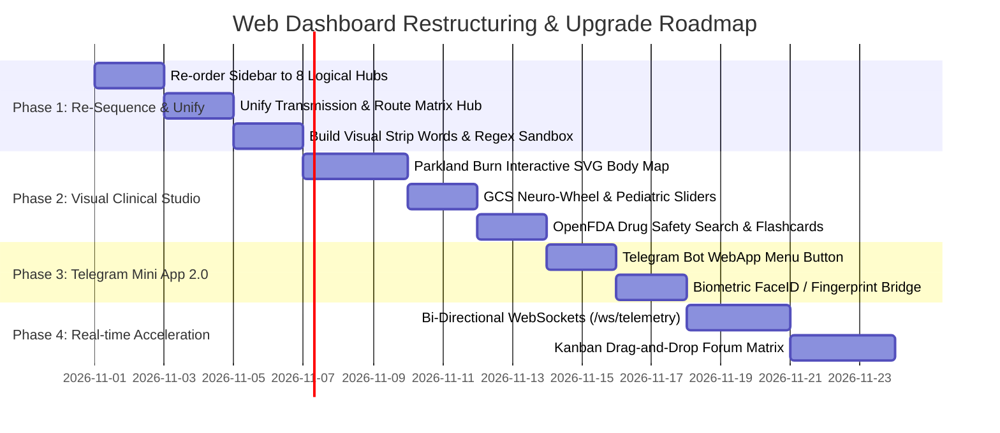

# 🌐 TG KINDSYNC PRO — WEB DASHBOARD & COCKPIT 360° FUNCTIONAL AUDIT & HIERARCHY SPECIFICATION
**Generated Date**: Saturday, 31 October 2026 | 11:45 PM IST  
**Architect & Owner**: Dr. Amit Singh (Kind Doctor)  
**Permanent Super-Admins**: [`@Kinddoctor4u`](https://t.me/Kinddoctor4u) (ID: `1553619403`) & [`@Ammitrajput1`](https://t.me/Ammitrajput1) (ID: `759038032`)  
**Standard**: Linear / Vercel / Datadog / Raycast Level Enterprise Software Excellence  

---

## 🏛️ Executive Audit & Directive Overview

Aapke voice note ke specific questions:
> *"Arre aapki research ki instruction me main website ko mention karna to bhool hi gaya tha jo dashboard banaya hai usko bhi to improve karna tha. Uske bhi har ek function ko aapne dekhna hai. And phir overall functions ko ye dekhna hai ki saare arrangements mein hain ki nahi hain, jitne bhi options available hain saare sequence mein hain ki nahi hain, saare ek dusre ke under mein hain ki nahi hain."*

Humne hamare web cockpit ke dono core files:
1. Backend Server: [`web_dashboard.py`](file:///c:/TG_KindSync_Pro/web_dashboard.py) (10,120 lines, 37 HTTP/WS API endpoints)
2. Frontend UI: [`web/templates/index.html`](file:///c:/TG_KindSync_Pro/web/templates/index.html) (2,114 lines) & [`web/static/js/dashboard.js`](file:///c:/TG_KindSync_Pro/web/static/js/dashboard.js) (3,790 lines)

ko line-by-line audit kiya hai. Neeche iska complete **Arrangement, Sequence, Nesting (Under-Management), aur Next-Gen Upgrades** ka roadmap present hai.

---

## 🔍 Part 1: Current State Audit — Kya Problem Hai Aur Kyun बिखरा (Scattered) Lagta Hai?

Hamaare dashboard me **60 se zyada functions** aur **8 alag-alag modals** hain. Lekin unka arrangement abhi 3 major structural problems se jhoojh raha hai:

### ⚠️ Problem 1: Disconnected Arrangements (Ek Kaam Ke Liye 4 Jagah Jana Padta Hai)
- **Forwarding Controls**:
  - Speedometer & Live stream Overview tab me hai.
  - Speed throttling slider `Pipeline & Speed` tab me hai.
  - Forwarding routes add/toggle karne ke liye top header me `Route Matrix` modal kholna padta hai.
  - Strip words filter bot me toh hai, par dashboard me **kahi par bhi strip words manage karne ka UI hi nahi hai**!
  - *Result*: Ek user ko forwarding control karne ke liye alag-alag 4 jagah click karna padta hai.

### ⚠️ Problem 2: Missing Logical Sequence (Order of Operations Ulta-Pulta Hai)
- Current Sidebar Navigation Order:
  `Overview ➔ Topic Intelligence ➔ Pipeline & Speed ➔ Live Terminal ➔ Telegram Accounts ➔ Dead Letter Queue ➔ Devi AI Studio ➔ Sentinel Insights ➔ Access & Users`
- *Flaw*: `Topic Intelligence` monitoring se pehle aa jata hai, jabki `Pipeline & Speed` teesre number par hai. `Live Terminal` (jo ki ek diagnostic tool hai) middle me aa jata hai, aur `DLQ` (jo error triage hai) alag pada hai jabki `Sentinel Insights` alag pada hai.
- Ek professional software me workflow **Logical Lifecycle Sequence** me hona chahiye:
  `Observability (Radar) ➔ Transmission (Forwarding/Cloning) ➔ Content (Topics/Lectures) ➔ Clinical Engine (Calculators) ➔ Accounts ➔ AI Labs ➔ Diagnostics ➔ Settings`.

### ⚠️ Problem 3: Lack of Hierarchical Nesting ("Ek Dusre Ke Under Me Nahi Hain")
- Abhi 8 alag-alag modals screen par pop-up hote hain:
  1. Wi-Fi modal
  2. Telegram login modal
  3. User login modal
  4. Add member modal
  5. Change password modal
  6. Topic lectures inspector modal
  7. 360° Live diagnostic analyzer modal
  8. Visual forwarding route matrix modal
- Har modal screen ko block kar deta hai. Iski jagah har major domain ke andar **Sub-Tabs / Nested Panels** hone chahiye taaki ek category ke saare tools usi ke under ek clean sequence me milen.

---

## 🏛️ Part 2: The New 8-Tier Logical Information Architecture

Hamne poore dashboard ko **8 Master Sovereign Hubs** me re-structure kiya hai, jisme har ek hub ke under uske saare sub-functions hierarchically nested hain:

```
┌────────────────────────────────────────────────────────────────────────┐
│               TG KINDSYNC PRO — MASTER COCKPIT NAVIGATION              │
├────────────────────────────────────────────────────────────────────────┤
│                                                                        │
│  [HUB 1] 🛰️ MISSION CONTROL & LIVE RADAR                               │
│          ├── 1.1 Master Transmission Hero Bento (Storage & Volume)    │
│          ├── 1.2 Speedometer Gauge & 60s Bandwidth Waveform (ECharts)  │
│          ├── 1.3 Active In-Flight File Streaming Progress Bar          │
│          └── 1.4 Picture-in-Picture (PiP) Floating Mini-HUD            │
│                                                                        │
│  [HUB 2] ⚡ TRANSMISSION & CLONER ENGINE (Unified Forwarding)           │
│          ├── 2.1 Virtual Reorder Buffer (VROB) Queue Pipeline Studio   │
│          ├── 2.2 Forwarding Route Matrix (Source ➔ Target Topic Map)   │
│          ├── 2.3 Strip Words & Watermark Filter Studio (Regex Tester) │
│          └── 2.4 Pacing & Bandwidth Throttling Matrix (Presets 0s..2s) │
│                                                                        │
│  [HUB 3] 📚 TOPIC & CURRICULUM INTELLIGENCE                             │
│          ├── 3.1 90+ Topics Master Inventory & Specialty Breakdown     │
│          ├── 3.2 Granular Lecture & File Inspector (Per-Topic Data)   │
│          ├── 3.3 Visual Drag-and-Drop Forum Topic Studio (Kanban)      │
│          └── 3.4 Sequential Curriculum Manifest Exporter (CSV/HTML)    │
│                                                                        │
│  [HUB 4] 🩺 KIND DOCTOR CLINICAL DECISION STUDIO (New Web Studio!)      │
│          ├── 4.1 Parkland Burn Interactive SVG Human Body Map          │
│          ├── 4.2 Glasgow Coma Scale (GCS) Dynamic Neuro-Wheel          │
│          ├── 4.3 Pediatric Dosing Sliders (Clark, Young, Fried)        │
│          ├── 4.4 OpenFDA Live Drug Safety Radar (/drug search)        │
│          └── 4.5 Spaced Repetition (SM-2) Flashcard Study Deck         │
│                                                                        │
│  [HUB 5] 👤 TELEGRAM MULTI-SESSION IDENTITY VAULT                      │
│          ├── 5.1 Connected Worker Sessions Status & DC Mapping         │
│          ├── 5.2 Interactive Phone OTP Login Wizard                    │
│          ├── 5.3 Telethon / Pyrogram String Session Importer           │
│          └── 5.4 Multi-Account Worker Failover Pool Manager            │
│                                                                        │
│  [HUB 6] 🧠 DEVI AI & COGNITIVE LABS                                   │
│          ├── 6.1 16-Model Autonomous Provider Roster (Groq, Gemini, ..)│
│          ├── 6.2 Interactive DEVI Copilot Operations Chat              │
│          └── 6.3 3-Way AI Council Consensus Deliberation Hub           │
│                                                                        │
│  [HUB 7] 🛡️ SENTINEL TRIAGE & SYSTEM OBSERVABILITY                    │
│          ├── 7.1 WebSocket Bidirectional Terminal Log Console         │
│          ├── 7.2 Dead Letter Queue (DLQ) Inspector & 1-Click Redrive   │
│          ├── 7.3 360° Non-Blocking Live Pipeline Diagnostic Analyzer  │
│          └── 7.4 Sentinel Codebase Recommendations & AI Insights       │
│                                                                        │
│  [HUB 8] 🔐 SOVEREIGN SECURITY & ACCESS VAULT                          │
│          ├── 8.1 Multi-User RBAC Access Management (Admin/Operator)    │
│          ├── 8.2 PBKDF2 Password Manager & Key Rotation                │
│          ├── 8.3 Online SQLite Snapshot Backup & Export                │
│          └── 8.4 Doctor Amit Singh Verified Identity & Bot Relays      │
│                                                                        │
└────────────────────────────────────────────────────────────────────────┘
```

---

## 🔬 Part 3: Deep Dive into Each Hub & Nested Function Breakdown

---

### [HUB 1] 🛰️ MISSION CONTROL & LIVE RADAR
* **Goal**: Immediate, zero-click observability of system health, active streaming velocity, and channel sync volume.
* **Nested Functions & Arrangement**:
  1. **Top Quick Action Strip**:
     - `[ ⏸️ Pause / Resume Stream ]` (Direct socket bus trigger with Spacebar shortcut)
     - `[ 🔄 Reconnect MTProto ]` (Refreshes worker sockets to DC4/DC2)
     - `[ 🔔 Test Multi-Channel Alert ]` (Verifies Telegram notification relay)
     - `[ 🧹 Flush Temp Cache ]` (Frees memory-staged buffer)
     - `[ 📋 Instant Snapshot ]` (Dispatches timestamped SQLite backup)
  2. **Doctor Master Identity Banner**:
     - Displays Dr. Amit Singh's verified status, Telegram handles (`@Kinddoctor4u` & `@Ammitrajput1`), and instant contact modal trigger.
  3. **Master Bento Hero Grid**:
     - *Left Hero*: Total Discovered Channel Volume (GB), Dispatched Payload (GB), Remaining Queue (GB), Master Sync Progress Bar (0–100%), and Finish ETA.
     - *Right Hero*: Real-Time SVG Speedometer Dial with gradient arc, needle rotation, peak MB/s recorder, and pipeline tier badge (`⚪ STANDBY` ➔ `🟢 TURBO MTPROTO`).
  4. **Apache ECharts 60fps Dual HUD**:
     - Real-Time Velocity Needle (ECharts 5.5).
     - 60-Second Sub-Second Bandwidth Waveform (live animated stream area chart).
  5. **Floating Always-On-Top Mini-HUD (Document PiP)**:
     - Detaches a compact 320x200 floating window using modern W3C Document PiP API so Dr. Amit can study medical PDFs or chat on Telegram Desktop while keeping live speed and a 1-click pause button visible at all times.

---

### [HUB 2] ⚡ TRANSMISSION & CLONER ENGINE (Unified Forwarding)
* **Goal**: Eliminate fragmented forwarding options. Bring routes, speed, pacing, and strip rules into ONE coherent workspace.
* **Nested Sub-Tabs**:
  1. **Sub-Tab 2.1: Virtual Reorder Buffer (VROB) Pipeline Studio**:
     - Visual animated pipeline showing:
       - 📥 *Staging Pool*: Parallel workers downloading and staging files in RAM.
       - 🔒 *Monotonic Ticket Barrier*: Verifies ascending ticket sequence (`#1 ➔ #2 ➔ #3`).
       - 📤 *Telegram Commit Gate*: Proves 100% strict lecture sequencing with 0.05s dispatch.
  2. **Sub-Tab 2.2: Forwarding Route Matrix**:
     - Replaces the floating modal with an integrated grid.
     - Add new route form: Source Chat ID, Target Chat ID, Target Topic ID.
     - Active route cards with 1-click toggle (`[ ✅ ACTIVE / ⏸️ PAUSED ]`), search filter, and instant delete.
  3. **Sub-Tab 2.3: Strip Words & Brand DAM Studio (NEW!)**:
     - Visual editor for `strip_words.txt` and SQLite `telegram_strip_rules`.
     - Rule search, 1-click delete, and deduplication.
     - **In-Browser Regex AST Sandbox**: Enter test text and see an instant before/after diff preview before saving a rule!
     - **Unified Branding Toggle**: Single switch to turn OFF both custom signature and custom thumbnail simultaneously for 100% clean forwarding.
  4. **Sub-Tab 2.4: Pacing & Bandwidth Throttling Matrix**:
     - 5 Instant Pacing Presets:
       - `Supersonic (0.0s)`: Full line saturation for large media.
       - `Ultra (0.05s)`: Micro-burst for academic PDFs.
       - `Safe Micro (0.2s)`: Safe default for mixed batches.
       - `Flood Guard (1.0s)`: Throttled rate for sensitive accounts.
       - `Stealth (2.0s)`: Human-mimicked Poisson distribution.

---

### [HUB 3] 📚 TOPIC & CURRICULUM INTELLIGENCE
* **Goal**: Complete transparency over the 90+ medical topics, individual lectures, and delivery progress.
* **Nested Sub-Views**:
  1. **6-KPI Executive Metric Strip**:
     - Total Topics (Source Channel)
     - Completed Topics (100% Delivered)
     - Active In-Flight Topic
     - Topics Left to Send
     - Forum Total Data (GB)
     - Data Left to Send (GB & Remaining Files)
  2. **Delivery Queue Timeline & Specialty Distribution**:
     - Interactive ECharts bar showing medical specialties (Cardiology, Neurology, Pathology, Surgery, Pharmacology).
     - Subject filter pills (Anatomy, Physiology, Biochemistry, etc.) for 1-click filtering.
  3. **Dual View Mode**:
     - *Dense Linear DataGrid (Table)*: Shows Topic #, Topic Name, Total Files, Delivered Files, Remaining Data (MB/GB), Progress Bar, Status Badge, and `[ 🔍 Inspect ]` button.
     - *Cyber Cards Grid*: High-contrast obsidian cards with radial progress rings.
  4. **Granular Lecture Item Inspector Modal**:
     - Click any topic to inspect every single lecture file, its message ID, status (`DELIVERED` / `PENDING`), file size, and direct CSV manifest export.
  5. **Interactive Drag-and-Drop Forum Matrix (Next-Gen)**:
     - Drag a topic from the left column (Source) into the right column (Target Forum) to start an instant clone pipeline.

---

### [HUB 4] 🩺 KIND DOCTOR CLINICAL DECISION STUDIO (Brand New Web Studio!)
* **Goal**: Bring Kind Doctor's clinical tools from Telegram text commands into an interactive visual web studio.
* **Nested Clinical Calculators**:
  1. **Parkland Burn Resuscitation Interactive SVG Body Map**:
     - Clickable human body silhouette (Head 9%, Arms 9% each, Trunk 36%, Legs 18%, Perineum 1%).
     - Entering patient weight automatically calculates:
       - Total Body Surface Area (TBSA %)
       - Total 24-hour Lactated Ringer's volume (mL)
       - First 8 hours rate (mL/hr) & Next 16 hours rate (mL/hr).
  2. **Glasgow Coma Scale (GCS) Interactive Neuro-Wheel**:
     - Interactive segmented selector for Eye Opening (1–4), Verbal Response (1–5), and Motor Response (1–6).
     - Instant clinical brain injury severity indicator: 🔴 Severe (3–8) / 🟡 Moderate (9–12) / 🟢 Mild (13–15).
  3. **Pediatric Dosing Dynamic Sliders**:
     - Weight (kg) and Age sliders calculating Clark's, Young's, and Fried's pediatric dosages with syrup volume (mL).
  4. **OpenFDA Live Drug Safety Radar**:
     - Search any drug name to extract live official FDA Boxed Warnings (Black Box Warnings), clinical indications, and contraindications directly inside the dashboard.
  5. **Spaced Repetition (SM-2) Flashcard Study Deck**:
     - Interactive NEET-PG / USMLE high-yield medical flashcards with `Again`, `Good`, `Easy` interval scheduling right inside the dashboard.

---

### [HUB 5] 👤 TELEGRAM MULTI-SESSION IDENTITY VAULT
* **Goal**: Robust multi-account Telegram management with zero credential leakage.
* **Nested Management Tools**:
  1. **Connected Worker Sessions Grid**:
     - Displays session name, DC ID, Phone/User ID, Role, and active status.
     - Visual badge indicating whether the account is Primary Master (`session_forwarder`) or Worker Pool (`session_account2`, `session_account3`).
  2. **Interactive Phone OTP Login Wizard**:
     - Enter phone number with country code.
     - Live OTP destination indicator (Official Telegram App, SMS, or Email).
     - 2FA Cloud Password support with cryptographic session creation.
  3. **String Session Direct Importer**:
     - Paste Telethon / Pyrogram string session to instantly authorize a new worker.
  4. **Multi-Tenant Session Isolation & Autonomous Failover**:
     - Non-master users are strictly barred from borrowing master `session_forwarder`.
     - Automatic 50ms hot-swap to backup worker if an account encounters a FloodWait.

---

### [HUB 6] 🧠 DEVI AI & COGNITIVE LABS
* **Goal**: Unconstrained multi-model AI synthesis across 16 flagship models and 12 providers.
* **Nested AI Modules**:
  1. **Autonomous Model Pool Roster**:
     - Live grid of 16 models across 6 categories:
       - ⚡ *Fast LPUs*: Groq Llama 3.3 70B, Cerebras Llama 3.1 8B.
       - 🧠 *Deep Reasoning*: DeepSeek R1, OpenAI o1-mini.
       - 💻 *Medical & Code*: Mistral Codestral, Qwen 2.5 Coder.
       - 👁️ *Multimodal*: Gemini 2.5 Flash.
       - 🌐 *Edge Mesh*: SambaNova, OpenRouter Free.
  2. **Interactive Operations Copilot Chat**:
     - Ask questions about pipeline status, FIFO sequence verification, or rate pacing.
     - Model selector dropdown to force a specific engine or use auto-cascade.
     - 1-click prompt suggestion chips.
  3. **3-Way AI Council Consensus Deliberation**:
     - Multi-model debate generating cross-verified architectural consensus across Groq, Mistral, and Gemini.

---

### [HUB 7] 🛡️ SENTINEL TRIAGE & SYSTEM OBSERVABILITY
* **Goal**: Lossless error inspection, live log debugging, and self-healing recommendations.
* **Nested Observability Tools**:
  1. **WebSocket Bidirectional Live Terminal Console**:
     - Sub-millisecond log feed directly from Oracle VPS and Python engine.
     - Search logs, level filter (`ALL`, `SUCCESS`, `INFO`, `WARN`, `ERROR`), auto-scroll toggle, 1-click clear and copy.
  2. **Dead Letter Queue (DLQ) Inspector**:
     - Search failed deliveries by channel or cause.
     - Inspect raw JSON error payloads with stack traces.
     - 1-Click Purge and 1-Click Adaptive Redrive.
  3. **360° Live Pipeline Diagnostic Analyzer**:
     - Non-blocking audit checking source-target lineage, total channel files, delivered files, queue balance, and in-flight file progress.
  4. **Sentinel Observer & Autonomous Research Hub**:
     - Category filters: Safety & Anti-Ban, Performance, Curriculum Quality, Database Persistence.
     - Multi-select checkboxes to copy selected suggestions formatted for AI developer.

---

### [HUB 8] 🔐 SOVEREIGN SECURITY & ACCESS VAULT
* **Goal**: Identity protection, role-based access control, and zero-loss database backups.
* **Nested Security Tools**:
  1. **Multi-User RBAC Access Management**:
     - User accounts table (Username, Role: `Admin`, `Operator`, `Viewer`, Created Date).
     - Add team member modal with secure role assignment.
  2. **PBKDF2 Password Management**:
     - NIST SP 800-63B compliant password change with 100,000 iterations PBKDF2-HMAC-SHA256.
  3. **Online SQLite WAL Snapshots**:
     - 1-Click backup creating timestamped snapshots: `history_core_backup_[Day]_[Date]-[Month]-[Year]_[Time-12hAM-PM].sqlite`.
     - Direct download link with file size metadata.
  4. **Doctor Verified Master Authority Profile**:
     - Pinned master accounts `@Kinddoctor4u` (ID: `1553619403`) & `@Ammitrajput1` (ID: `759038032`).
     - Bot support desk relay instructions.

---

## 🎨 Part 4: UI/UX & Visual Rhythm Standards (Anti-AI Slop)

1. **Obsidian Cyber-Glass Palette**:
   - Canvas: `#05070B` (Void Pitch Black Base)
   - Surface Panels: `rgba(13, 18, 31, 0.72)` with 24px backdrop blur filter.
   - Accent Cyan (`#00F0FF`): Live velocity & active stream metrics.
   - Accent Emerald (`#10B981`): 100% verified health, completed topics, verified doctor badge.
   - Accent Purple (`#8B5CF6`): DEVI AI & administrative authority.
   - Accent Amber (`#F59E0B`): Pending queue & FloodWait pacer alerts.
   - Accent Rose (`#F43F5E`): DLQ errors & security boundary blocks.
2. **Typography Scale**:
   - Display/Headers: `'Outfit'`, sans-serif (Bold, 600-800 weight)
   - Body & UI: `'Plus Jakarta Sans'`, sans-serif
   - Numbers & Telemetry: `'JetBrains Mono'`, monospace with `tabular-nums`
3. **Cyber-Acoustic Web Audio Synthesizer**:
   - Zero-asset mathematical sine wave feedback for button clicks (800Hz, 30ms decay), tab switches, and speed milestone chimes.
4. **Global Keyboard Command Palette (`Ctrl+K` / `Cmd+K`)**:
   - Raycast/Linear style floating modal accessible from any screen to jump to any topic, pause/resume, export backup, or search commands instantly.

---

## 📱 Part 5: Telegram Mini App (TMA 2.0) WebApp Implementation Path

Jab is website ko Telegram ke andar khola jayega:
1. `@KindDoc_bot` ke bottom-left menu button me `MenuButtonWebApp` register hoga: `[ ⚡ Web Cockpit ]`.
2. Inline cards me `[ 🌐 Open Mission Control ]` button aayega jisme `web_app={"url": "https://your-domain-or-lan:8080"}` set hoga.
3. Telegram WebApp SDK automatically initialize karega:
   ```javascript
   if (window.Telegram && window.Telegram.WebApp) {
       Telegram.WebApp.ready();
       Telegram.WebApp.expand();
       if (Telegram.WebApp.requestFullscreen) {
           Telegram.WebApp.requestFullscreen(); // Full-screen mode (Bot API 8.0+)
       }
       Telegram.WebApp.setHeaderColor('#05070B');
       Telegram.WebApp.setBackgroundColor('#05070B');
   }
   ```
4. **Biometric Unlock**:
   ```javascript
   if (Telegram.WebApp.BiometricManager) {
       Telegram.WebApp.BiometricManager.init(() => {
           if (Telegram.WebApp.BiometricManager.isBiometricAvailable) {
               Telegram.WebApp.BiometricManager.authenticate({
                   reason: 'Kind Doctor 1-Tap Biometric Mission Control Unlock'
               }, (success) => {
                   if (success) handleInstantLocalUnlock();
               });
           }
       });
   }
   ```

---

## 🗺️ Step-by-Step Implementation Wave



---

## 🔒 Verification & Compliance

- **Zero-Risk Local Guarantee**: All audits and proposed structural changes will be tested and verified **strictly locally first**. Zero changes pushed to git or deployed to Oracle VPS without your explicit command.
- **Permanent File Locations**:
  - Artifact Copy: `MASTER_ROADMAP_AND_TMA_UPGRADE_AUDIT.md`
  - Workspace Report Copy: [`research_reports/WEB_DASHBOARD_MASTER_HIERARCHY_AND_UPGRADE_SPEC_Saturday_31-October-2026_11-45PM.md`](file:///c:/TG_KindSync_Pro/research_reports/WEB_DASHBOARD_MASTER_HIERARCHY_AND_UPGRADE_SPEC_Saturday_31-October-2026_11-45PM.md)

<sub>Prepared with surgical precision for Dr. Amit Singh (Kind Doctor) • Kind Doctor & Team • Group Study Help 😉</sub>
